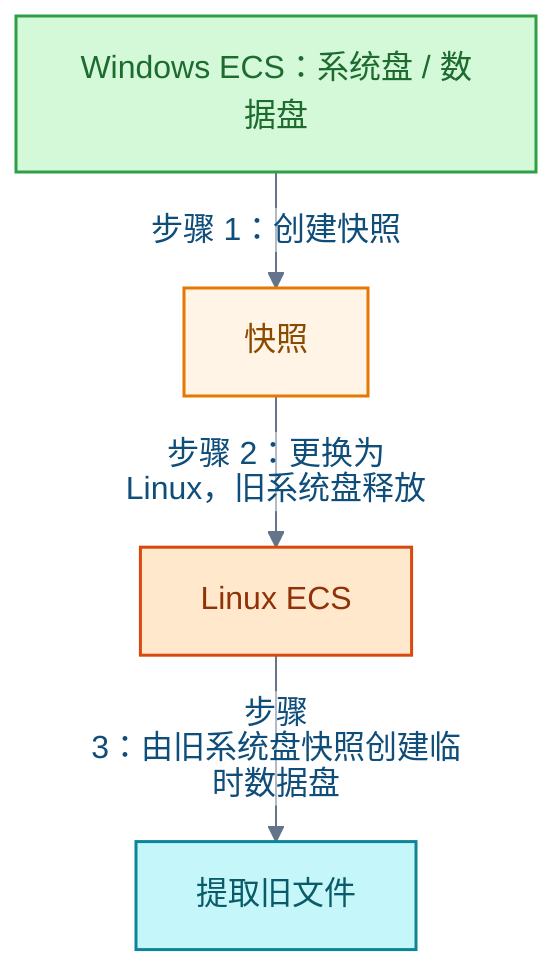

# 云存储

本领域记录阿里云的两条主线：对象存储（Object Storage Service，OSS）长期低频备份的成本构成；弹性计算服务（Elastic Compute Service，ECS）从 Windows 更换为 Linux 时，用云盘快照迁移数据的方法与限制。

## OSS 长期备份的成本

**结论**：按中国内地公共云、本地冗余、长期存放且很少恢复计算，OSS 备份的容量成本可以较低。但容量单价并非总成本：外网流出、数据取回、请求费用另计，选型必须把恢复时的流量与取回费用一并计入。

**各存储类型的容量单价**：按官网目录价，1 TB 持续存放 1 个月（按量计费）：

| 存储类型 | 目录价 | 官网折扣价 |
| --- | --- | --- |
| 标准 | 122.88 元 | 92.16 元 |
| 低频 | 81.92 元 | 71.68 元 |
| 归档 | 33.79 元 | 30.72 元 |
| 冷归档 | 15.36 元 | — |
| 深度冷归档 | 7.68 元 | — |

归档、冷归档、深度冷归档的容量单价逐级降低，代价是最低存储期和恢复等待时间增加：

- 归档最低存储期 60 天；冷归档和深度冷归档最低 180 天。
- 小于 64 KB 的对象按 64 KB 计费，小文件多时实际容量会被抬高。

**恢复成本**：上传流入免费。互联网下载、冷数据取回、请求另计；完整恢复 1 TB 数据，白天的外网流量目录价约 512 元，可能远超数月的容量费用。

**取舍**：选型需同时看保留时长、恢复频率、恢复时限和备份版本累计容量。实际账单还取决于版本累计容量、地域、冗余类型和优惠。

**信源**：

- [一手] [阿里云 OSS 产品定价](https://cn.aliyun.com/price/detail/oss)
- [一手] [OSS 存储类型](https://help.aliyun.com/zh/oss/user-guide/overview-53/)
- [一手] [OSS 存储费用](https://help.aliyun.com/zh/oss/storage-fees)

## 更换操作系统时用云盘快照迁移数据

**结论**：若实例是阿里云 ECS 且位于中国内地地域，可以先对旧系统盘和数据盘创建快照，再更换为 Linux。快照能救回文件，但不能把 Windows 环境整体搬到 Linux：应用和数据库仍需迁移。

**流程**：

- 先对旧系统盘和数据盘分别创建快照。
- 更换操作系统会释放旧系统盘。
- 旧系统盘快照不能回滚到新的 Linux 系统盘，只能用来创建临时数据盘，从盘中提取文件。

**限制与例外**：

- Windows 应用需要重装或替换为 Linux 版本。
- 数据库需保证一致性并另行迁移，不能靠拷盘完成。
- NTFS 数据盘在 Linux 下需要额外工具读取。
- 中国内地以外地域不能在同一实例上跨操作系统类型更换。

**信源**：

- [一手] [更换系统盘（更换操作系统）](https://help.aliyun.com/zh/ecs/user-guide/replace-the-operating-system-of-an-instance-1)
- [一手] [旧系统盘快照恢复数据](https://help.aliyun.com/zh/ecs/user-guide/use-a-snapshot-of-the-original-system-disk-to-restore-data-after-the-operating-system-of-an-ecs-instance-is-replaced)
- [一手] [手动创建单个快照](https://help.aliyun.com/zh/ecs/user-guide/create-a-snapshot)
