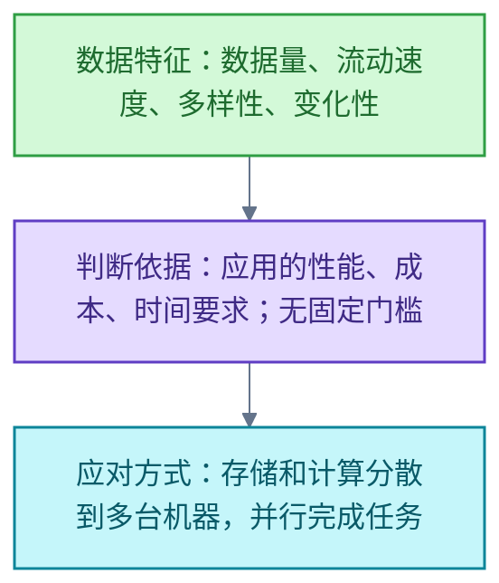

# 大数据

<!-- domain: 大数据 -->
**范围**：大数据的概念、数据特征与可扩展存储和计算。

**综述**：大数据（Big Data）的关键是数据特征推动处理架构改变：数据量（Volume）、流动速度（Velocity）、多样性（Variety）与变化性（Variability）使系统需要可扩展架构来高效存储、处理和分析数据。是否属于大数据问题，取决于应用的性能、成本与时间要求，没有统一的容量门槛。常见应对方式是把存储和计算分散到多台机器，并行完成任务。
<!-- /domain -->

大数据（Big Data）领域关注数据特征如何推动处理架构改变。主线是从数据量、速度、多样性与变化性出发，判断何时需要可扩展架构；边界是判断依据为应用的性能、成本与时间要求，而非固定容量。

## 大数据的概念与判断依据

**结论**：大数据指因数据量（Volume）、流动速度（Velocity）、多样性（Variety）或变化性（Variability）等特征，需要可扩展架构才能高效存储、处理和分析的数据集。是否属于大数据问题，取决于应用的性能、成本与时间要求，没有统一的容量门槛。

**原因**：上述四个特征使系统需要可扩展架构，才能高效存储、处理和分析数据。应对方法是把存储和计算分散到多台机器，并行完成任务。

**限制与例外**：不存在统一的容量门槛；同一数据集是否算大数据，随应用的性能、成本与时间要求而变。

**信源**：

- [一手] [NIST SP 1500-1r2：Big Data Interoperability Framework，Volume 1，Definitions，Version 3（2019），第 3.1–3.2 节](https://nvlpubs.nist.gov/nistpubs/SpecialPublications/NIST.SP.1500-1r2.pdf)
- [一手] [Apache Hadoop 官方介绍](https://hadoop.apache.org/)

### 证据与时效 · q-20261010-006

- **信源**：[一手] [NIST SP 1500-1r2：Big Data Interoperability Framework，Volume 1，Definitions，Version 3（2019），第 3.1–3.2 节](https://nvlpubs.nist.gov/nistpubs/SpecialPublications/NIST.SP.1500-1r2.pdf)；[一手] [Apache Hadoop 官方介绍](https://hadoop.apache.org/)

## 提问记录

### q-20261010-006

- **原题**：2026-10-10 · 什么是大数据
- **问**：什么是大数据
- **领域**：大数据
- **首次**：2026-10-10
- **更新**：2026-10-10
- **正文**：[大数据的概念与判断依据](#大数据的概念与判断依据)
