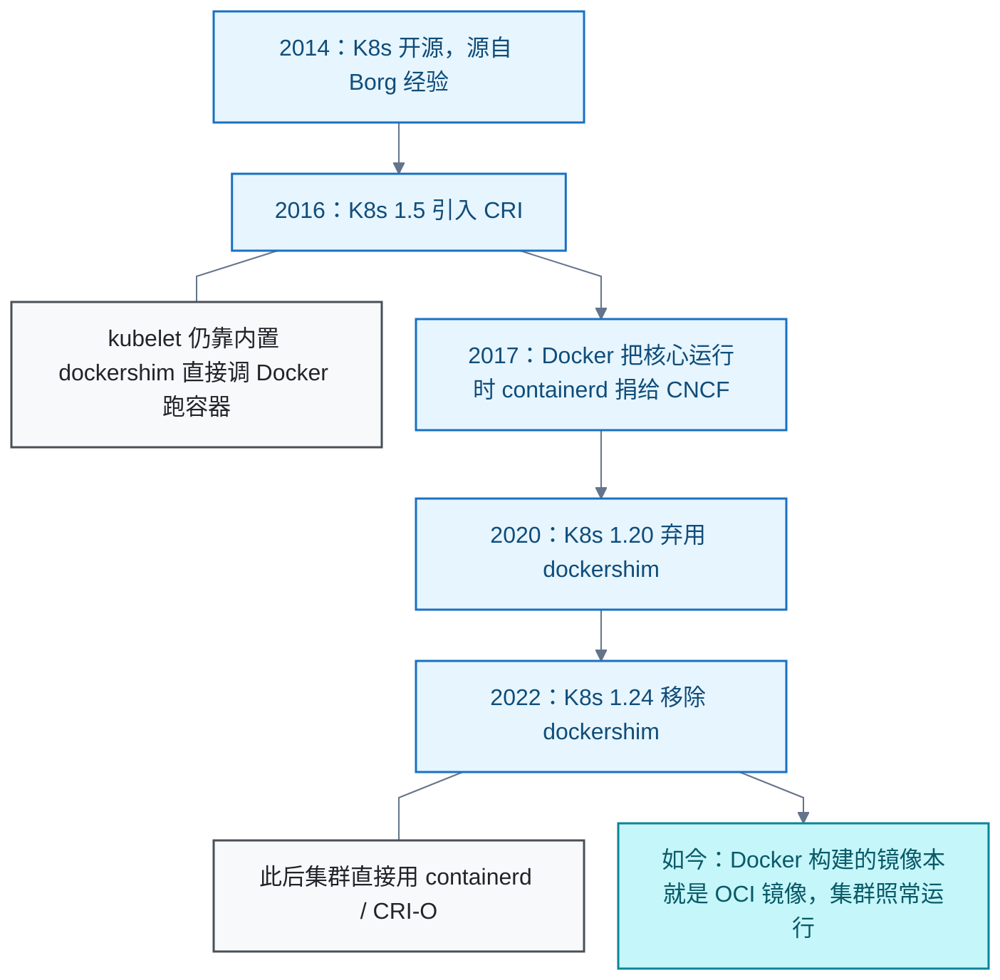
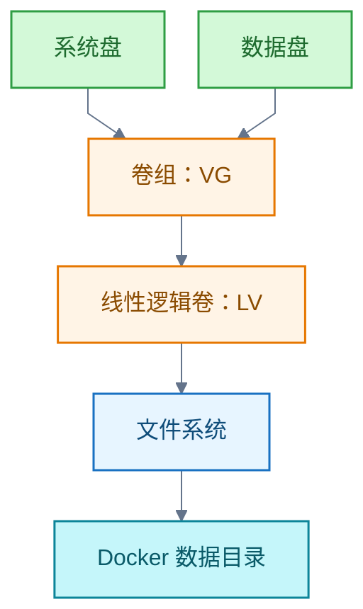

# 容器编排

<!-- domain: 容器编排 -->
**范围**：容器化部署、Kubernetes 原理与生态。

**综述**：K8s 是声明式 API + 控制循环的容器管理平台（Google 2014 年开源，源自内部 Borg 经验，CNCF 托管）：声明期望状态，控制器持续把集群现实收敛到期望，据此自动完成部署、扩缩容、自愈与流量分发。与 Docker 曾绑定（kubelet 内置 dockershim）、后经 CRI 标准解耦（1.24 移除 shim）；今日分工——Docker 造 OCI 镜像，集群用 containerd 跑镜像。在 Java 服务端学习路线中，本领域位于应用构建、单机交付之后；学习重点是镜像、配置、资源限制、探针、优雅停机、发布与回滚，以及应用和平台的责任边界。Docker 本机存储容量取决于其存储目录所在的文件系统，跨盘合并容量应在主机存储层完成；Docker Engine 29.0 起全新安装默认使用 containerd 镜像存储，镜像和容器快照默认位于 /var/lib/containerd，其位置不受 Docker data-root 控制。
<!-- /domain -->

本领域围绕 Kubernetes 与 Docker：声明式 API 加控制循环的管理机制、两者从绑定到解耦的演进，以及 Docker 本机存储目录与跨盘容量的取舍。在 Java 服务端学习路线中，本领域位于应用构建、单机交付之后。

## Kubernetes 是什么

**结论**：Kubernetes（K8s）是 Google 2014 年开源、现由云原生计算基金会（Cloud Native Computing Foundation，CNCF）托管的容器管理平台，源自 Google 内部集群系统 Borg 的经验。

**机制**：核心是声明式 API 加控制循环。你声明期望状态，控制器持续把集群现实收敛到期望，据此自动完成部署、扩缩容、自愈与流量分发。官方文档刻意不以"编排"自称。

**信源**：

- [一手] [Kubernetes 官方概念文档](https://kubernetes.io/docs/concepts/overview/)
- [一手] [Borg：Kubernetes 的前身（Kubernetes 官方博客）](https://kubernetes.io/blog/2015/04/borg-predecessor-to-kubernetes/)
- [一手] [Kubernetes 从开源到 CNCF 毕业的故事（Google Cloud 博客）](https://cloud.google.com/blog/products/gcp/from-open-source-to-sustainable-success-the-kubernetes-graduation-story)

### 证据与时效 · q-20260921-003

- **信源**：[一手] https://kubernetes.io/docs/concepts/overview/ · [一手] https://kubernetes.io/blog/2015/04/borg-predecessor-to-kubernetes/ · [一手] https://cloud.google.com/blog/products/gcp/from-open-source-to-sustainable-success-the-kubernetes-graduation-story

## Kubernetes 与 Docker：从绑定到解耦

**结论**：两者曾绑定、后解耦。今天的关系是"开发用 Docker 造镜像，集群用 containerd 跑镜像"，集群与 Docker 无直接依赖。

**演进**：

**要点**：

- 早期 K8s 靠 kubelet 内置的 dockershim 直接调 Docker 跑容器。
- 移除 dockershim 后，Docker 构建的镜像仍可在集群运行，因为它们本就是 OCI 镜像。

**条件**：本节结论核实至 2026-09-21；2026-09-23 的更新仅补充学习路线关联，未重新核实原结论。

**信源**：

- [一手] [别慌：Kubernetes 与 Docker（Kubernetes 官方博客）](https://kubernetes.io/blog/2020/12/02/dont-panic-kubernetes-and-docker/)
- [一手] [dockershim 常见问题（Kubernetes 官方博客）](https://kubernetes.io/blog/2020/12/02/dockershim-faq/)
- [一手] [containerd 加入 CNCF（CNCF 公告）](https://www.cncf.io/announcements/2017/03/29/containerd-joins-cloud-native-computing-foundation/)

### 证据与时效 · q-20260921-004

- **信源**：[一手] https://kubernetes.io/blog/2020/12/02/dont-panic-kubernetes-and-docker/ · [一手] https://kubernetes.io/blog/2020/12/02/dockershim-faq/ · [一手] https://www.cncf.io/announcements/2017/03/29/containerd-joins-cloud-native-computing-foundation/ · 链接修正 2026-11-01（原 cncf.io 路径 404）

## Docker 存储目录与跨盘容量

**结论**：Docker 不会自动汇总主机上独立文件系统的剩余容量。要跨盘合并容量，须先在主机存储层建立对应文件系统，再配置 Docker 存储位置。

**目录与配置**：

- 常规 Linux Docker 的数据目录默认是 /var/lib/docker，可用 data-root 修改。
- Docker Engine 29.0 起全新安装默认使用 containerd 镜像存储。此时镜像与容器快照默认位于 /var/lib/containerd，须单独配置 containerd 的 root；只改 data-root 不控制其位置。

**跨盘合并的做法与取舍**：可以用逻辑卷管理器（Logical Volume Manager，LVM）把两盘纳入管理的空间组成跨盘线性逻辑卷，在其文件系统上存放 Docker 数据。仅创建卷组或挂载数据盘不会自动合并 Docker 可用容量。

**限制与例外**：

- 线性卷不保证均匀或并行读写，也无冗余；任一盘故障可能使跨盘文件系统不可用。
- 已有非 LVM 系统分区需规划迁移。
- 若只想减轻系统盘占用，可以保持两盘独立并迁移 Docker 存储；使用 containerd 镜像存储时，须分别考虑 Docker 的 data-root 与 containerd 的 root。

**信源**：

- [一手] [Docker：守护进程存储目录配置](https://docs.docker.com/engine/daemon/)
- [一手] [Docker：containerd 镜像存储](https://docs.docker.com/engine/storage/containerd/)
- [一手] [Red Hat：LVM 逻辑卷创建与扩容](https://docs.redhat.com/en/documentation/red_hat_enterprise_linux/10/html/configuring_and_managing_logical_volumes/basic-logical-volume-management)
- [一手] [Linux 内核：dm-linear 映射机制](https://www.kernel.org/doc/html/latest/admin-guide/device-mapper/linear.html)
- [一手] [Red Hat：RAID 与线性存储的容量、性能和冗余](https://docs.redhat.com/en/documentation/red_hat_enterprise_linux/10/html/configuring_and_managing_logical_volumes/configuring-raid-logical-volumes)
- [一手] [Red Hat：LVM 物理卷初始化](https://docs.redhat.com/en/documentation/red_hat_enterprise_linux/10/html/configuring_and_managing_logical_volumes/managing-lvm-physical-volumes)

### 证据与时效 · q-20261002-001

- **信源**：[一手] [Docker：守护进程存储目录配置](https://docs.docker.com/engine/daemon/)；[一手] [Docker：containerd 镜像存储](https://docs.docker.com/engine/storage/containerd/)；[一手] [Red Hat：LVM 逻辑卷创建与扩容](https://docs.redhat.com/en/documentation/red_hat_enterprise_linux/10/html/configuring_and_managing_logical_volumes/basic-logical-volume-management)

## 提问记录

### q-20260921-003

- **原题**：2026-09-21 · 什么是 Kubernetes
- **问**：什么是 k8s
- **领域**：容器编排
- **首次**：2026-09-21
- **更新**：2026-09-21
- **正文**：[Kubernetes 是什么](#kubernetes-是什么)

### q-20260921-004

- **原题**：2026-09-21 · k8s 和 Docker 的关系（承接上条）
- **问**：k8s 和 docker 之间是什么关系
- **领域**：容器编排
- **首次**：2026-09-21
- **更新**：2026-09-23
- **正文**：[Kubernetes 与 Docker：从绑定到解耦](#kubernetes-与-docker从绑定到解耦)
- **关联**：[2026-09-22 · 成为 Java 专家的完整学习路线](../软件开发/java/index.md#q-20260922-001)；[2026-09-23 · 从零基础到 Linux 专家的完整学习路线与知识地图](Linux.md#q-20260923-009)

### q-20261002-001

- **原题**：2026-10-02 · Docker 存储目录与系统盘、数据盘合并的关系
- **问**：系统盘与数据盘能否合并，让安装 Docker 容器时自然用到两块盘？（关联条目，主记录见 Linux）
- **领域**：容器编排
- **首次**：2026-10-02
- **更新**：2026-10-02
- **正文**：[Docker 存储目录与跨盘容量](#docker-存储目录与跨盘容量)
- **关联**：[2026-10-02 · 系统盘与数据盘合并后供 Docker 使用的方式与取舍](Linux.md#q-20261002-002)
