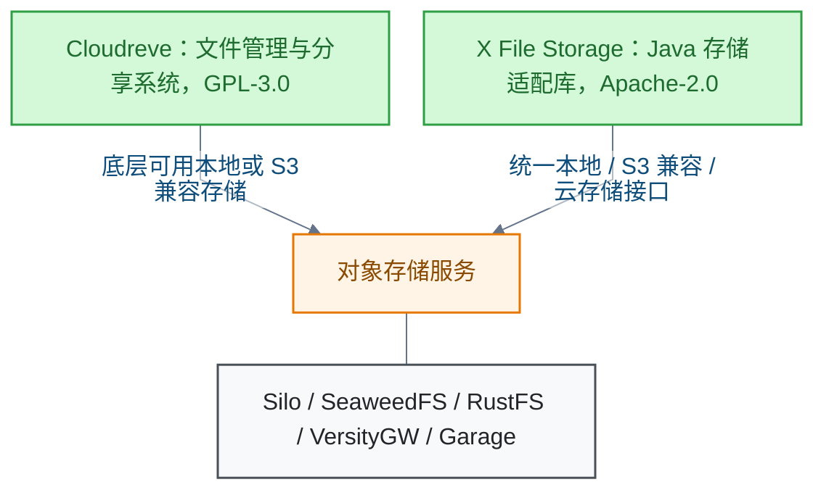
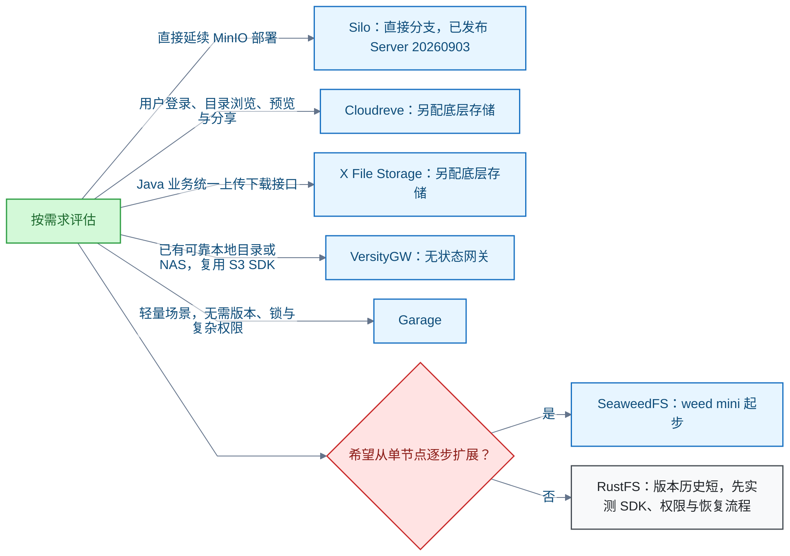

# 对象存储

<!-- domain: 对象存储 -->
**范围**：对象存储软件的产品演进、开源维护、替代选型与项目文件管理。

**综述**：判断对象存储软件是否继续运营，需区分公司业务、产品发布与开源仓库维护。已有核实表明 MinIO 仍有 AIStor 订阅、支持与发布活动，但原开源 minio/minio 仓库于 2026-04-25 归档；AIStor Free 需申领许可证并限定单个计算资源，公开产品活动不能证明公司内部财务状况。2026-10-13 深化到项目文件管理：Silo 是保留 MinIO 兼容面的直接分支，当前已发布 Server 为 20260903，2026-09-16 是主分支存在未发布改动的说明日期；新建文件存储可评估 SeaweedFS、RustFS、VersityGW 或 Garage，选择取决于部署规模、底层存储、权限与版本需求。SeaweedFS 提供对象与文件接口，RustFS 已发布 1.0.1 但兼容范围须按发布标签核实，VersityGW 适合把已有目录暴露为 S3，Garage 适合轻量异地副本且缺少 S3 版本、策略、ACL 与对象锁。Cloudreve 是完整文件管理系统，X File Storage 是 Java 存储适配库；二者与对象存储服务处于不同层。S3 API 兼容不保证管理接口、权限语义或磁盘格式兼容；本次选型是有条件的架构判断，未做部署或性能实测，最终仍需核实项目规模与是否需要用户文件管理界面。
<!-- /domain -->

本领域记录自托管对象存储（Object Storage）的两条主线：一是 MinIO 原开源仓库停止维护后，如何判断公司仍在经营；二是项目文件存储的替代方案与分层选型。结论均来自官方文档、仓库与发布页，未做部署实测。

## MinIO 是否停止经营

**结论**：MinIO 公司没有公开迹象显示停止经营，但其原开源仓库已停止维护。"公司是否还在干"必须拆成三层独立判断：公司业务、产品发布、开源仓库维护。任何一层的事实都不能推出另一层的结论。

| 判断层面 | 已核实的事实 | 结论 |
| --- | --- | --- |
| 公司业务 | 公开渠道无法核实内部财务 | 不能证明倒闭 |
| 产品发布 | AIStor 订阅、支持与发布仍活动 | 商业线仍运营 |
| 开源仓库维护 | minio/minio 于 2026-04-25 归档 | 已停止维护 |

**关键事实**：

- 原开源仓库 [minio/minio](https://github.com/minio/minio) 已于 2026-04-25 归档，附停止维护声明。[一手]
- AIStor 商业线仍有订阅、支持与发布活动，见[官方下载与订阅说明](https://www.min.io/download)。[一手]
- AIStor Free 需申领许可证，且限定单个计算资源，见[升级文档与免费许可证说明](https://docs.min.io/aistor/administration/upgrade-aistor-server/)。[一手]

**限制**：公开产品活动不能证明公司内部财务状况，反之亦不能凭仓库归档断言公司倒闭。

## Silo：MinIO 的直接延续

**结论**：想延续 MinIO 部署，可以评估 Silo。Silo 是保留 MinIO 兼容面的直接分支。

**发布边界**：官方 README 写明最新已发布 Server 为 20260903。2026-09-16 是"main 分支存在未发布改动（安全、存储与 Console）"的说明日期，不是发布日。不能把说明日期或主分支提交日期当成发布日。

**修正**：旧结论"最新版 2026-09-16 发版、仓库活跃"已被 2026-10-13 修正，以 [Silo README 的 Current release and main branch](https://github.com/pgsty/silo#current-release-and-main-branch) 为准。[一手]

## MinIO 平替：四个自托管方案的取舍

**结论**：除 Silo 外，四个方案按场景评估：SeaweedFS、RustFS、VersityGW、Garage。它们的定位与已核实能力如下。

| 能力 | SeaweedFS | RustFS | VersityGW | Garage |
| --- | --- | --- | --- | --- |
| 定位 | 独立对象与文件存储 | 独立 S3 对象存储 | S3 网关 | 轻量分布式 S3 存储 |
| 许可证 | Apache-2.0 | Apache-2.0 | Apache-2.0 | AGPL-3.0 |
| 已核实最新发布 | 4.48 | 1.0.1 | 未核实 | v2.4.1（2026-09-08） |
| 对象版本（Object Versioning） | 支持 | 部分支持（按 1.0.1 矩阵） | POSIX 后端标 experimental | 不支持 |
| 对象锁（Object Lock） | 支持 | 部分（按 1.0.1 矩阵） | 未核实 | 不支持 |
| 桶策略（Bucket Policy） | 支持 | 支持 | 未核实 | 不支持 |
| ACL | 未核实 | 有意不支持 | 未核实 | 不支持 |

表中"未核实"表示记录中没有该能力的结论，不代表支持或反对。

**SeaweedFS**：提供对象与文件两类接口。`weed mini` 把各组件放进单个进程，适用于单节点和小集群文件存储，但只运行一个 master；多 master 高可用需分组件部署。架构包含 master、volume、filer 三种组件，适合从单节点逐步扩展的业务文件服务。注意：官方 wiki 的接口清单属于持续更新文档，不能当作 4.48 的完整交付清单；本次未独立验证指定版本的全部接口、性能或可靠性。

**RustFS**：官方于 2026-09-16 宣布 1.0.0 正式发布，最新发布为 1.0.1。兼容性必须按发布标签内的矩阵核实：1.0.1 标签的矩阵确认核心对象操作、分片上传（Multipart Upload）、预签名链接（presigned URL）的 GET/PUT、桶策略，以及部分版本、对象锁、CORS 行为；矩阵只保证已覆盖的功能，不宣称完整 S3 兼容。ACL（Access Control List，访问控制列表）授权是有意不支持；桶访问日志、POST 表单上传校验和、桶所有权控制等仍有未通过或未实现范围。main 分支 README 的 Available/Preview 清单属于主分支，官网兼容文档注明采用 2026-08-09 提交快照，二者都不能当作已发布二进制的完整交付清单。MinIO 磁盘兼容在 main 分支标为 Preview 且默认构建未启用，不能据此承诺原地迁移；主分支说明还明确不能读取 MinIO 加密对象。正式版本历史较短，采用前应验证实际 SDK、权限和恢复流程；"成熟度优于其它项目"未核实。

**修正**：旧综述称 RustFS"纠删码/bitrot/版本控制/对象锁/复制齐备"，已被 2026-10-13 修正。新结论按具体发布标签、测试范围与构建开关表述：官方功能清单、已实现处理函数和已通过兼容测试是不同证据，不能凭 main 分支的功能标签认定发布版本完整支持全部 S3 语义。

**VersityGW**：S3 网关，把本地目录或挂载目录暴露为 S3 服务。网关自身无状态，数据保护与容灾由底层存储承担。适合项目已有可靠本地存储或 NAS、目标是复用 S3 SDK 的场景。POSIX 后端的对象版本功能仍标为 experimental。不能把它当作自带分布式复制的完整对象存储。

**Garage**：轻量、自包含的分布式 S3 对象存储。官方镜像仓库说明作者自 2020 年起用于生产服务。支持核心对象操作、分片上传、预签名链接与 CORS。官方兼容表明确不支持对象版本、桶策略、ACL、对象锁、S3 桶复制接口及标签；授权改用每访问密钥与每桶的自有机制。注意：集群内部副本与 S3 桶复制 API 是不同能力，不能写成"不支持任何复制"。适合不需要复杂 S3 权限和历史版本的小型业务或异地副本。

**信源**：

- SeaweedFS：[一手] [官方仓库](https://github.com/seaweedfs/seaweedfs)、[Apache-2.0 LICENSE](https://github.com/seaweedfs/seaweedfs/blob/master/LICENSE)、[S3 接口与语义差异](https://github.com/seaweedfs/seaweedfs/wiki/Amazon-S3-API)、[weed mini 用途与单 master 限制](https://github.com/seaweedfs/seaweedfs/wiki/Quick-Start-with-weed-mini)、[4.48 发布页](https://github.com/seaweedfs/seaweedfs/releases/tag/4.48)
- RustFS：[一手] [官方仓库与状态清单](https://github.com/rustfs/rustfs)、[Apache-2.0 LICENSE](https://github.com/rustfs/rustfs/blob/main/LICENSE)、[1.0.0 正式发布公告](https://rustfs.com/blog/announcing-rustfs-1-0-0-ga/)、[1.0.1 发布页](https://github.com/rustfs/rustfs/releases/tag/1.0.1)、[1.0.1 标签内 S3 兼容矩阵](https://github.com/rustfs/rustfs/blob/1.0.1/docs/architecture/s3-compatibility-matrix.md)、[官网兼容文档及快照日期](https://docs.rustfs.com/en/reference/s3-compatibility)
- VersityGW：[一手] [官方仓库](https://github.com/versity/versitygw)、[POSIX 后端及版本限制](https://github.com/versity/versitygw/wiki/POSIX-Backend)
- Garage：[一手] [官方 GitHub 镜像](https://github.com/deuxfleurs-org/garage)、[AGPL-3.0 LICENSE](https://github.com/deuxfleurs-org/garage/blob/main-v2/LICENSE)、[官方功能说明](https://garagehq.deuxfleurs.fr/documentation/reference-manual/features/)、[官方 S3 兼容表](https://garagehq.deuxfleurs.fr/documentation/reference-manual/s3-compatibility/)、[官方发布列表](https://garagehq.deuxfleurs.fr/_releases.html)

- **SeaweedFS**：独立对象与文件存储系统，Apache-2.0；支持上传、下载、分片上传、预签名链接、CORS、桶策略、对象版本与对象锁。官方 `weed mini` 将各组件放在一个进程，适用于单节点和小集群文件存储，但只运行一个 master；多 master 高可用需要分组件部署。架构包含 master、volume、filer，适合希望从单节点逐步扩展的业务文件服务。当前官方 wiki 的接口清单属于持续更新文档，不能直接当作 4.48 的完整交付清单。最新发布为 4.48，仓库与发布活动持续；本次未独立验证指定版本的全部接口、性能或可靠性。[一手] [官方仓库](https://github.com/seaweedfs/seaweedfs)、[Apache-2.0 LICENSE](https://github.com/seaweedfs/seaweedfs/blob/master/LICENSE)、[S3 接口与语义差异](https://github.com/seaweedfs/seaweedfs/wiki/Amazon-S3-API)、[weed mini 用途与单 master 限制](https://github.com/seaweedfs/seaweedfs/wiki/Quick-Start-with-weed-mini)、[4.48 发布页](https://github.com/seaweedfs/seaweedfs/releases/tag/4.48)。

- **Silo 发布边界修正**：旧结论“最新版 2026-09-16 发版”与“2026-09-16 发版、仓库活跃”**已被 2026-10-13 修正**。官方 README 当前明确最新已发布 Server 为 20260903；2026-09-16 说明 main 有尚未进入 Server 发布的安全、存储与 Console 改动，不能把说明日期或主分支提交日期当成发布日。[一手] [Silo README 的 Current release and main branch](https://github.com/pgsty/silo#current-release-and-main-branch)。

- **条件与待确认**：本次只核实官方文档、仓库与发布页面，未下载、部署或实测。选择取决于单节点或集群、数据规模、现有存储、后端语言、是否需要用户文件管理界面，以及是否需要版本、锁和复杂权限；以上尚未由用户说明，不能据此确定唯一方案。

### 证据与时效 · q-20261010-001

- **信源**：原问题一手资料：[MinIO 官方开源仓库及停止维护声明](https://github.com/minio/minio)、[AIStor 官方下载与订阅说明](https://www.min.io/download)、[AIStor 升级文档与免费许可证说明](https://docs.min.io/aistor/administration/upgrade-aistor-server/)、[Ceph Object Gateway 官方文档（Tentacle）](https://docs.ceph.com/en/tentacle/radosgw/)；本次已核实的一手资料见下方各项目证据。
- 原记录资料（未在迁移时复核）：[资料](https://github.com/pgsty/silo，还有没有)

## Cloudreve 与 X File Storage：存储服务之上的两层

**结论**：如果"文件管理"指用户登录、目录浏览、预览与分享，评估 Cloudreve；如果 Java 业务只需要统一上传下载接口，评估 X File Storage。二者都不是对象存储服务，与存储服务处于不同层。

**Cloudreve**：GPL-3.0 的完整自托管文件管理与分享系统。支持本地和 S3 兼容存储、用户组、预览与到期分享链接。限制：官方明确它不是其它网盘的管理器，不能让其它文件管理器同时直接管理 Cloudreve 的底层文件。

**X File Storage**：Apache-2.0 的 Java/Spring Boot 存储适配库。统一本地、S3 兼容和云存储接口，提供分片上传与预签名链接能力。它不是对象存储服务，也不直接提供用户文件管理系统。

**信源**：

- Cloudreve：[一手] [官方仓库](https://github.com/cloudreve/Cloudreve)、[官方文档](https://docs.cloudreve.org/en/)、[API 与底层文件管理边界](https://docs.cloudreve.org/en/api/overview)
- X File Storage：[一手] [官方仓库](https://github.com/dromara/x-file-storage)

## 选型的共同边界

**S3 API 兼容不保证管理接口、权限语义或磁盘格式兼容**。判断兼容范围必须看具体发布标签内的证据，不能看主分支清单。

选型路径按已核实的适用条件展开：

**限制**：本次只核实官方文档、仓库与发布页面，未下载、部署或实测，属于有条件的架构判断。最终选择取决于单节点或集群、数据规模、现有存储、后端语言、是否需要用户文件管理界面，以及是否需要版本、锁和复杂权限；这些条件尚未确认，不能据此确定唯一方案。

## 提问记录

### q-20261010-001

- **原题**：2026-10-10 · MinIO 公司是否倒闭或停止经营
- **问**：minio 这个公司是倒闭不干了吗？追问：有什么替代方案吗？再追问：minio 平替或更优解？本次追问：除了 https://github.com/pgsty/silo，还有没有 MinIO 的平替或相关项目，用于项目中文件管理？
- **领域**：对象存储
- **首次**：2026-10-10
- **更新**：2026-10-13
- **正文**：[MinIO 平替：四个自托管方案的取舍](#minio-平替四个自托管方案的取舍)
