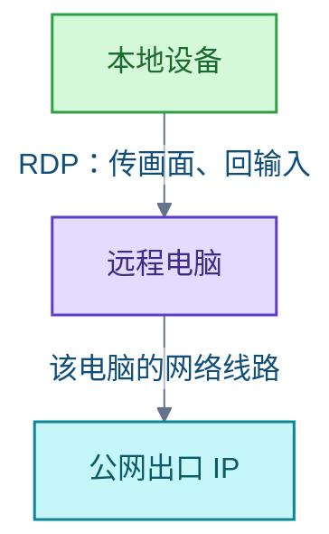

# 远程办公

<!-- domain: 远程办公 -->
**范围**：远程电脑订阅、住宅 IP 出口与跨境办公接入方案。

**综述**：美国云电脑可按月订阅并提供完整 Windows 桌面，但默认出口是云服务网络，不等于住宅 IP。市场上有商家出售标称住宅 IP 的远程桌面；线路性质目前只有商家声明，第三方平台是否接受该 IP 也无保证。若必须从真实家庭宽带出网，最可控的方式是在美国住宅部署自有电脑，再用远程桌面连接；办公资料能否放入第三方电脑还需符合所在单位的规定。远程桌面协议（Remote Desktop Protocol，RDP）负责传输远程画面与本地输入；它本身不决定远程电脑的上网出口或 IP 类型。商家将“RDP”用作远程电脑产品名时，应区分协议、电脑与网络线路。
<!-- /domain -->

本领域记录两件事：远程桌面协议（Remote Desktop Protocol，RDP）的作用与边界，以及如何获得一台出口为美国住宅 IP 的远程办公电脑。RDP 只传输画面与输入，不决定出口 IP；标称住宅 IP 的商家云电脑未经独立核实。

## RDP 是什么，与住宅 IP 有何关系

**结论**：RDP 通过网络把远程 Windows 电脑的画面传给本地设备，并把本地键盘和鼠标操作传回远程电脑。RDP 是连接协议，本身不决定远程电脑的上网出口或 IP 类型。

三层概念应区分：

- **协议**：RDP 只负责传输画面与输入。
- **电脑**：商家把远程电脑产品叫"RDP 电脑"，指那台电脑本身。
- **网络线路**：出口 IP 是住宅还是机房，由远程电脑接入的网络决定。

因此不能从"RDP"名称推断出口是住宅 IP。

信源：

- [微软 RDP 开发文档（一手）](https://learn.microsoft.com/en-us/windows/win32/termserv/remote-desktop-protocol)
- [Windows 365 网络部署说明（一手）](https://learn.microsoft.com/en-us/windows-365/enterprise/windows-365-network-deployment-options)
- [ResidentialVPS 产品页（一手）](https://www.residentialvps.com/RDP/)

### 证据与时效 · q-20260923-008

- **信源**：[一手] [微软 RDP 开发文档](https://learn.microsoft.com/en-us/windows/win32/termserv/remote-desktop-protocol)；[一手] [Windows 365 网络部署说明](https://learn.microsoft.com/en-us/windows-365/enterprise/windows-365-network-deployment-options)；[一手] [ResidentialVPS 产品页](https://www.residentialvps.com/RDP/)

## 美国住宅 IP 远程电脑的订阅与选择

**结论**：有商家提供标称美国住宅 IP 的 Windows 远程桌面月租。例如 ResidentialVPS 的 Starter 标价 34.95 美元/月。但住宅 IP 声明未独立核实，也不保证第三方 IP 检测结果。

三条路线比较：

- **商家标称住宅 IP 的远程桌面**：线路性质只有商家声明；第三方平台是否接受该 IP 无保证。
- **Windows 365 云电脑**：正规云电脑服务，但微软托管网络的出口是微软管理的公网 IP，不是住宅 IP。
- **自有电脑放美国住宅**：若必须保证真实家庭宽带出口，这是最可控的方式——在美国住宅部署自有电脑，再用远程桌面连接（可用 Chrome Remote Desktop 等工具）。

**限制**：办公资料能否放入第三方电脑，须符合所在单位的规定。

信源：

- [ResidentialVPS 产品与价格（一手）](https://www.residentialvps.com/RDP/)
- [ResidentialVPS 服务条款（一手）](https://www.residentialvps.com/Legal/Terms.html)
- [ResidentialVPS 退款政策（一手）](https://www.residentialvps.com/Legal/Refund.html)
- [Windows 365 网络部署说明（一手）](https://learn.microsoft.com/en-us/windows-365/enterprise/windows-365-network-deployment-options)
- [Chrome Remote Desktop 官方设置说明（一手）](https://support.google.com/chrome/answer/1649523?hl=en)

### 证据与时效 · q-20260923-007

- **信源**：[一手] [ResidentialVPS 产品与价格](https://www.residentialvps.com/RDP/)；[一手] [ResidentialVPS 服务条款](https://www.residentialvps.com/Legal/Terms.html)；[一手] [ResidentialVPS 退款政策](https://www.residentialvps.com/Legal/Refund.html)；[一手] [Windows 365 网络部署说明](https://learn.microsoft.com/en-us/windows-365/enterprise/windows-365-network-deployment-options)；[一手] [Chrome Remote Desktop 官方设置说明](https://support.google.com/chrome/answer/1649523?hl=en)

## 提问记录

### q-20260923-007

- **原题**：2026-09-23 · 美国住宅 IP 远程电脑如何订阅与选择
- **问**：如何订阅一台美国住宅ip的远程电脑。在上面办公。有没有这样的服务
- **领域**：远程办公
- **首次**：2026-09-23
- **更新**：2026-09-23
- **正文**：[美国住宅 IP 远程电脑的订阅与选择](#美国住宅-ip-远程电脑的订阅与选择)
- **关联**：[2026-10-10 · VPS 是什么](VPS.md#q-20261010-004)

### q-20260923-008

- **原题**：2026-09-23 · RDP 是什么以及与住宅 IP 有何关系
- **问**：什么是rdp
- **领域**：远程办公
- **首次**：2026-09-23
- **更新**：2026-09-23
- **正文**：[RDP 是什么，与住宅 IP 有何关系](#rdp-是什么与住宅-ip-有何关系)
