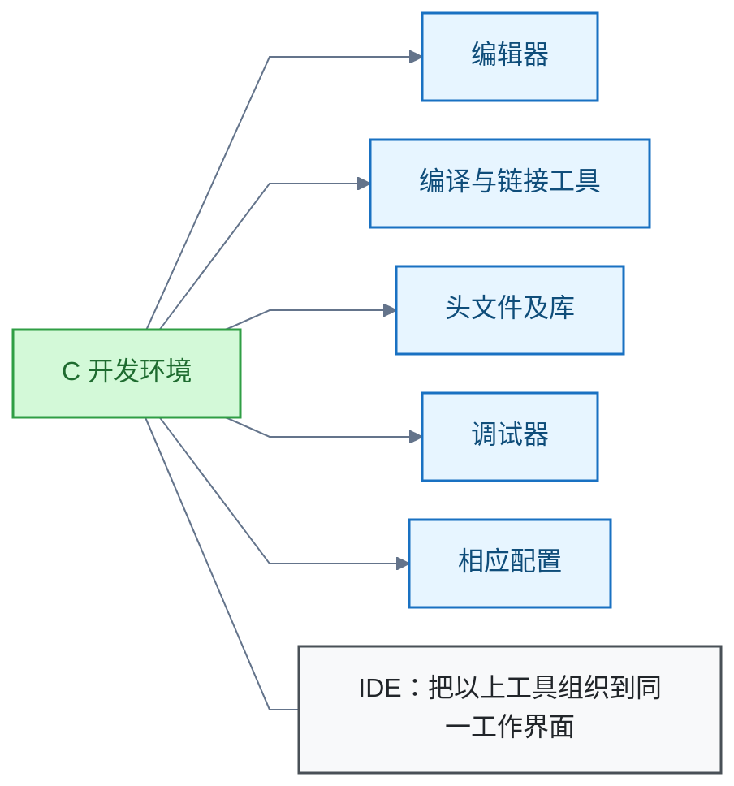
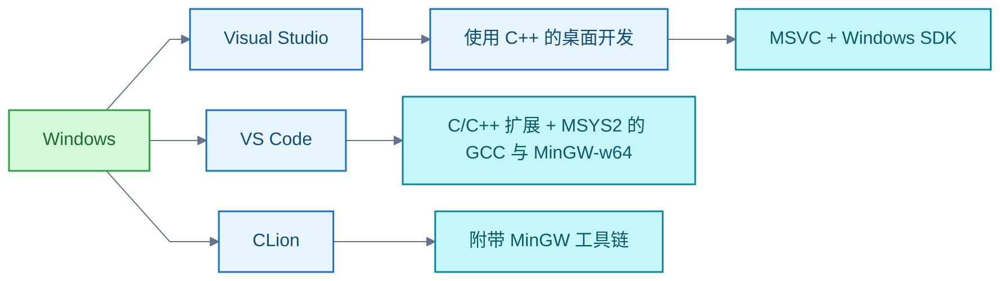

# C 语言

C 开发环境需要编辑器、编译与链接工具、头文件及库、调试器和相应配置；集成开发环境（Integrated Development Environment，IDE）把这些工具组织到同一工作界面。主线：Windows 上开发环境的选型与搭建。

## Windows 上的 C 开发环境、工具链与 IDE 选择

C 开发环境由五部分组成，IDE 把它们放进同一工作界面：



Windows 上有三条路线：



**选型结论**：

- 想减少配置：选 Visual Studio。安装"使用 C++ 的桌面开发"工作负载，它配置 Microsoft Visual C++（MSVC）与 Windows SDK，并按 C 语言编译 `.c` 文件。
- 想直接掌握编译命令：选 VS Code。它的 C/C++ 扩展不附带编译器与调试器，需配合 MSYS2 分发的 GNU 编译器集合（GNU Compiler Collection，GCC）与 MinGW-w64 工具链。
- CLion 在 Windows 上附带 MinGW 工具链。

选型依据：配置便利性、目标平台、工程习惯。

**GCC 路线的搭建步骤（x64 Windows）**：

1. 选 MSYS2 的 UCRT64 环境。
2. 把 UCRT64 的 `bin` 目录加入用户 `Path`。
3. 先用命令行验证编译，再连接编辑器的构建与调试功能。

验证命令：

```bash
gcc -std=c17 -Wall -Wextra -g main.c -o main.exe
```

C17 是本次示例基线。

**条件、例外与限制**：

- 例外：使用 `g++` 时，默认把 `.c` 文件按 C++ 处理。
- 学习 C 应明确选择 `.c`、C 编译方式和语言标准。
- 记录未确认用户的 Windows 版本、处理器架构及课程要求。

**关键信源**：

- [一手] [Visual Studio：安装 C/C++ 支持](https://learn.microsoft.com/en-us/cpp/build/vscpp-step-0-installation?view=msvc-170)
- [一手] [Visual Studio：配置 C11/C17 支持](https://learn.microsoft.com/en-us/cpp/overview/install-c17-support?view=msvc-170)
- [一手] [VS Code：C/C++ 扩展与外部工具要求](https://code.visualstudio.com/docs/languages/cpp)
- [一手] [VS Code：Windows GCC/MinGW 配置](https://code.visualstudio.com/docs/cpp/config-mingw)
- [一手] [MSYS2：安装与系统要求](https://www.msys2.org/)
- [一手] [MSYS2：环境及 UCRT64 选择](https://www.msys2.org/docs/environments/)
- [一手] [MinGW-w64：项目说明](https://www.mingw-w64.org/)
- [一手] [CLion：安装与附带工具链](https://www.jetbrains.com/help/clion/installation-guide.html)
- [一手] [GCC：编译阶段与总体选项](https://gcc.gnu.org/onlinedocs/gcc/Overall-Options.html)
- [一手] [GCC：C 语言标准选项](https://gcc.gnu.org/onlinedocs/gcc/C-Dialect-Options.html)
- [一手] [GCC：警告选项](https://gcc.gnu.org/onlinedocs/gcc/Warning-Options.html)
- [一手] [GCC：调试信息选项](https://gcc.gnu.org/onlinedocs/gcc/Debugging-Options.html)
- [一手] [GCC：gcc 与 g++ 的语言处理差异](https://gcc.gnu.org/onlinedocs/gcc/Invoking-G_002b_002b.html)
