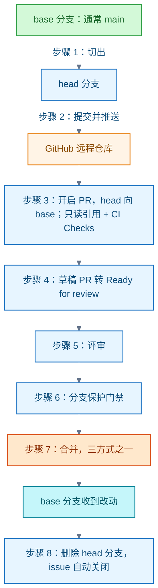

# Git

Git 是分布式版本控制系统，Bash 是命令解释器，GitHub 在 Git 之上提供拉取请求（Pull Request，PR）合并提案机制。本领域记录 Git Bash 环境中三者的分工，以及 PR 从建分支到合并的完整流程、门禁与限制。

## Git Bash：Git 与 Bash 的分工

**结论**：Git Bash 是 Git for Windows 提供的 Bash 命令行环境。它让 Windows 用户按类 Unix 方式执行 Git 与配套工具。

理解 Git Bash 需要区分三层：

- **Git**：负责版本管理。
- **Bash**：负责解释命令。
- **Git for Windows**：把上述工具带到 Windows 的软件包。

例子：在仓库目录执行 `git status` 时，Bash 解释这条命令并调用 Git，由 Git 显示工作区状态。

信源：

- [Git for Windows（一手）](https://gitforwindows.org/)
- [Git 官方首页（一手）](https://git-scm.com/)
- [GNU Bash：What is Bash?（一手）](https://www.gnu.org/software/bash/manual/html_node/What-is-Bash_003f.html)
- [git-status 官方文档（一手）](https://git-scm.com/docs/git-status)

## Pull Request：从建分支到合并

**结论**：PR 是 GitHub 的合并提案机制，是平台功能而非 Git 命令。在 head 分支（源）上提交并推送后，向 base 分支（目标）开启 PR；经评审与门禁后合并，随后删除 head 分支。

各阶段要点：

1. **建分支**：从 base 分支（通常为 main）切出 head 分支，命名短且描述性。改动隔离在 head，base 只保留完成并通过审查的工作。
2. **提交并推送**：每个提交保持孤立、完整，便于回滚。推送即远程备份，协作者可见。
3. **开启 PR**：选 head 向 base，写标题与摘要（改了什么、为什么、如何验证）。描述中用 `Closes #编号` 等关键词关联 issue，合并后自动关闭。GitHub 自动按 CODEOWNERS 请求评审，并在服务端创建只读引用 `refs/pull/N/head` 与 `refs/pull/N/merge`（后者模拟合并结果，仅在无冲突时存在）；同时触发 CI（如 GitHub Actions），结果显示在 Checks 标签页。
4. **草稿 PR（Draft PR）**：不能被合并，也不自动请求代码所有者。标记 "Ready for review" 后转为正式 PR 并请求评审。
5. **评审**：有读权限者即可评审，结论三种——Comment（仅评论）、Approve（批准）、Request changes（要求修改）；行内评论可附建议改动。作者向 head 分支继续提交推送，PR 与 Checks 自动更新。
6. **门禁**：合并前必须无合并冲突。仓库的分支保护规则可要求指定数量的批准、必需检查通过或特定团队批准；未满足时合并按钮停用，合并状态框列明原因。
7. **合并三方式**，均需在仓库设置中开启，合并者需写权限：
   - **合并提交（merge commit）**：保留全部提交并追加合并提交，对应 `--no-ff`。
   - **squash and merge**：压成单个提交快进合入，历史简洁。长生命周期分支不建议使用，否则后续 PR 会反复冲突。
   - **rebase and merge**：逐个提交变基到 base，线性历史、无合并提交；提交 SHA 与提交者信息被改写。
   - 无写权限者（fork 贡献）由有权限者执行合并。
   - 间接合并：head 提交经其他途径已可达 base 时，PR 自动标记为已合并（squash/rebase 除外）。
8. **合并后**：提示删除 head 分支。PR 记录与提交历史保留，分支可恢复，可用还原（revert）撤销整个 PR；关联 issue 在此刻自动关闭。

**限制与适用条件**：以上为 2026-10-27 核实的 GitHub Docs 当前版行为，适用 Free/Pro/Team 计划；fork 场景的深层权限差异未展开。

信源：

- [GitHub flow（一手）](https://docs.github.com/en/get-started/using-github/github-flow)
- [About pull requests（一手）](https://docs.github.com/en/pull-requests/collaborating-with-pull-requests/proposing-changes-to-your-work-with-pull-requests/about-pull-requests)
- [About pull request merges（一手）](https://docs.github.com/en/pull-requests/collaborating-with-pull-requests/incorporating-changes-from-a-pull-request/about-pull-request-merges)
- [About pull request reviews（一手）](https://docs.github.com/en/pull-requests/collaborating-with-pull-requests/reviewing-changes-in-pull-requests/about-pull-request-reviews)

<!-- backlinks:start -->

## 引用本页的文章

- [Java](java/index.md)

<!-- backlinks:end -->
