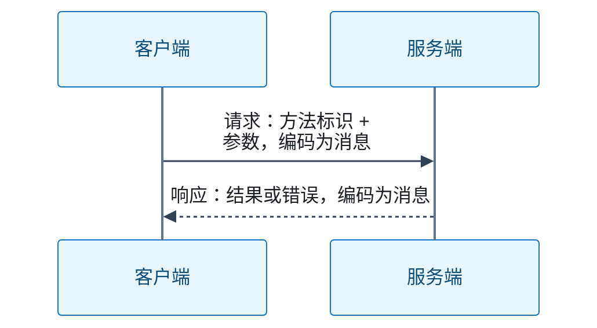

# RPC

远程过程调用（Remote Procedure Call，RPC）让程序以调用函数的形式请求另一个进程执行操作。主线：RPC 的含义、调用过程与协议边界。

## RPC 的含义、调用过程与协议边界

**结论**：RPC 是通用调用机制，不是某一种具体协议。它让程序以调用函数或方法的形式，请求另一个进程执行操作；两个进程可以位于不同计算机。具体协议各自定义消息格式与语义：ONC RPC 有独立协议规范；gRPC 是具有自身协议的 RPC 框架。协议规定业务方法、参数、结果、错误、请求响应匹配等规则。

**调用过程**：典型的一次请求、一次响应如下：

- 客户端把方法标识与参数编码为消息。
- 服务端解码并执行方法。
- 服务端把结果或错误传回客户端。

**RPC 与 HTTP 的关系**：超文本传输协议（Hypertext Transfer Protocol，HTTP）是应用层通信协议，规定请求方法、请求与响应、头字段、状态码等通用语义。RPC 可以通过 HTTP 实现：gRPC 的协议基于 HTTP/2；JSON-RPC 也允许以 HTTP 承载。两者是不同层面的东西，不是互斥选择。

**与「HTTP 接口调用」的差异**：差异属于接口设计与工具层面，不是非此即彼：

- 按资源组织的 HTTP 接口与按业务方法组织的 RPC 接口是接口设计上的比较；HTTP 接口可以采用 RPC 风格，不能把 HTTP 等同于资源式接口。
- gRPC 等框架统一服务接口、消息编码与调用状态，并可生成两端代码；HTTP 接口也可以借助 OpenAPI 生成客户端。因此方法式调用写法不能单独判定接口风格。

**限制与例外**：框架可以封装通信细节，但远程调用仍有编码与网络开销，以及独立的网络、服务端故障：

- 调用超时不代表服务端未执行。
- 重试可能重复操作。

**信源**：

- [一手] [RFC 5531：ONC RPC Version 2，第 4、5、8 节](https://www.rfc-editor.org/rfc/rfc5531.html)
- [一手] [gRPC 核心概念与调用生命周期](https://grpc.io/docs/what-is-grpc/core-concepts/)
- [一手] [gRPC 官方源码仓库：概念与 HTTP/2 协议实现](https://github.com/grpc/grpc/blob/master/CONCEPTS.md)
- [一手] [RFC 9110：HTTP Semantics，第 3、9 节](https://www.rfc-editor.org/rfc/rfc9110.html)
- [一手] [JSON-RPC 2.0 规范，第 1、4、5 节](https://www.jsonrpc.org/specification)
- [一手] [OpenAPI 官方说明：HTTP 接口描述与客户端代码生成](https://www.openapis.org/what-is-openapi)

<!-- backlinks:start -->

## 引用本页的文章

- [Java](java/index.md)

<!-- backlinks:end -->
