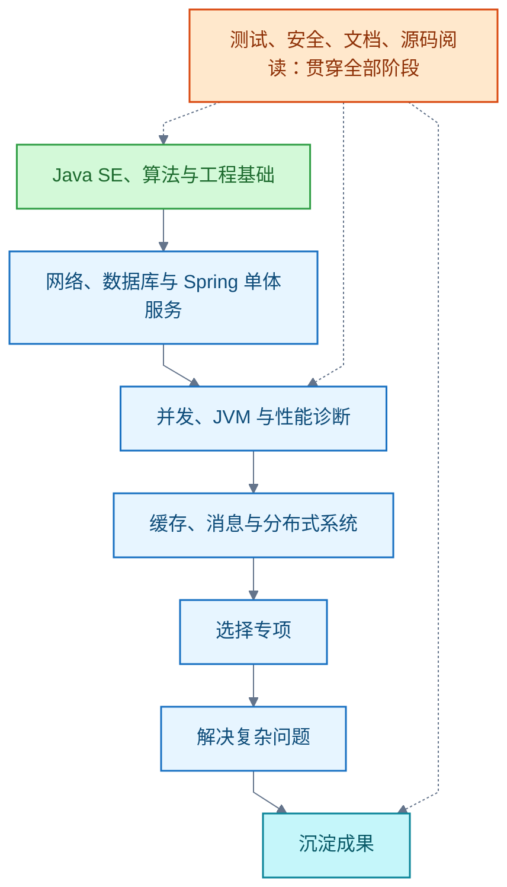

# Java

<!-- domain: Java -->
**范围**：Java 专家主路线、服务端工程、JVM 与日志专项及 Java EE 名称演变。

**综述**：Java 专家路线从语言与标准库连接到算法、操作系统、并发、虚拟机、服务端工程和生产交付；先形成可测试的服务，再以故障诊断和设计取舍深化专项，知识清单不表示已经掌握。Java SE 的详细路线见 [Java SE](java-se/语言与标准库.md)。日志按事件、API、实现、输出及采集理解，区分应用、审计与 JVM 日志。JVM 先理解规范语义，再按版本研究实现并用可复现故障验收：跨平台靠各平台 JVM 执行同一字节码，HotSpot 在运行时探测热点并即时编译为本机代码，优化属实现而非规范。Java EE／Jakarta EE 是规范集合，Tomcat 实现其中的 Web 层子集；学习方向应按实际工程需求选择。待解：个人薄弱项和可持续学习时间。
<!-- /domain -->

Java 专题收拢 Java 家族的文章：[Java SE：语言与标准库](java-se/语言与标准库.md)、[JDK：版本演化与类库体系](java-se/jdk.md)、[Java 图形化编程](java-se/图形化.md)、[JVM](jvm.md)、[Java 日志](日志.md)、[Spring](spring.md) 与 [Java EE 与 Tomcat](java-ee.md)。Java 领域围绕服务端 Java 展开：专家学习路线、日志体系、虚拟机机制与企业平台规范。主线是先形成可测试的服务，再以故障诊断与设计取舍深化专项；知识清单不等于已经掌握。本导读只放路线、书籍与家族概览，具体知识见上述文章。

## Java 专家的学习路线：18 个领域与专项

**结论**：建议覆盖 18 个主干领域，并在运行时与性能、框架与基础设施、分布式系统或安全等方向中选一个专项深入。验收按「会实现 → 能解释原理 → 能诊断故障 → 能论证取舍」递进。领域划分、顺序和验收要求是基于一手资料的学习建议，不是官方统一认证标准。

### 主线与阶段标记

标记含义：A＝先掌握，B＝完成单体服务后深入，C＝按专项选学。A 与 B 是阶段，不代表能力上限。练习可以沿用 JDK 21，再用 JDK 25 对照版本差异；语言特性、API、预览状态和框架兼容性以对应版本文档为准。

Java 标准版（Java Platform, Standard Edition，Java SE）的细化路线是独立专题，见 [Java SE：语言与标准库](java-se/语言与标准库.md)；本节只展开总路线。

### 18 个领域与验收目标

基础与运行机制（1—5）：

| 领域与阶段 | 知识点 | 验收目标 |
| --- | --- | --- |
| 2．数据结构与算法（A → B） | 时间与空间复杂度；摊还分析；数组、链表、栈、队列、哈希表、堆、树、图；二分、排序、递归、遍历、分治、贪心、动态规划；进一步理解红黑树、B+ 树、跳表、布隆过滤器 | 根据数据规模、访问方式和内存预算选结构；解释集合与数据库索引为何这样设计 |
| 3．操作系统与硬件基础（A → B） | 进程、线程、调度、上下文切换；用户态与内核态；虚拟内存、分页、文件系统、页缓存；文件描述符、系统调用；CPU 缓存、局部性、原子指令、缓存行与伪共享 | 区分计算、内存、磁盘与网络瓶颈；解释线程增加后性能可能下降的原因 |
| 4．并发编程（A 基础，B 深入） | 线程状态；中断、取消、超时；synchronized、volatile、wait/notify、Lock、Condition；Java 内存模型（Java Memory Model，JMM）、happens-before、安全发布；比较并交换（Compare-and-Set，CAS）、原子类；线程池、队列、拒绝策略；Future、CompletableFuture、ForkJoinPool；ConcurrentHashMap；Semaphore、CountDownLatch；ThreadLocal；死锁、饥饿；虚拟线程；抽象队列同步器（AbstractQueuedSynchronizer，AQS）源码 | 实现有界并发任务处理；证明共享状态的正确性；模拟超时、取消、拒绝和死锁并定位原因 |
| 5．Java 虚拟机（B） | Java 虚拟机（Java Virtual Machine，JVM）规范与 HotSpot 实现的区别；class 文件、字节码；类加载、链接、初始化与类加载器；栈、堆、方法区与 HotSpot 元空间；对象分配与引用类型；垃圾回收（Garbage Collection，GC）、可达性、安全点；G1、ZGC；即时编译（Just-In-Time Compilation，JIT）、内联、逃逸分析、反优化；直接内存、类卸载、内存泄漏 | 从线程转储、堆转储、GC 日志和性能记录分析内存不足、锁竞争与延迟问题；明确结论适用的 JDK 与实现 |

| 领域与阶段 | 知识点 | 验收目标 |
| --- | --- | --- |
| 6．开发工具与构建（A） | IDE 调试、条件断点、调用栈；Git 分支、合并、回退与审查；Maven 生命周期、依赖传递、版本冲突、scope、BOM、插件、多模块、Wrapper；按需学习 Gradle；日志、配置、文档、依赖升级、可重复构建 | 新环境能够构建、测试并运行项目；定位一次依赖冲突 |
| 7．网络与 Web（A → B） | TCP/IP、DNS；连接建立、超时、重传；HTTP 方法、状态码、报文头、缓存、幂等语义；TLS；Cookie、Session；跨域与浏览器同源策略；Servlet 生命周期、Filter、Listener、容器；接口契约、分页、版本、错误响应；WebSocket、HTTP/2、远程过程调用（Remote Procedure Call，RPC）按需深入 | 说明一次请求从客户端到数据库再返回的完整路径；用抓包和日志定位超时 |
| 8．关系数据库（A → B） | 关系建模、主外键、约束、范式；SQL、JOIN、聚合、子查询、窗口函数；索引、执行计划、统计信息；事务原子性、一致性、隔离性、持久性（ACID）；隔离级别、多版本并发控制（Multi-Version Concurrency Control，MVCC）、锁、死锁；预写日志（Write-Ahead Logging，WAL）、恢复；复制、备份、表结构迁移 | 使用 MySQL 或 PostgreSQL 完成建模；解释并修复慢查询与并发写冲突；不将某个数据库的实现泛化到所有数据库 |
| 9．Java 数据访问（A → B） | Java 数据库连接（Java Database Connectivity，JDBC）；DataSource、连接池、PreparedStatement、批处理、事务与资源关闭；MyBatis 映射、动态 SQL、插件；或 Jakarta Persistence / Hibernate 的实体状态、关联、脏检查、延迟加载；N+1 查询、分页、乐观锁、数据库迁移工具 | 从业务方法追到实际 SQL、连接和事务；解释框架隐藏了什么、哪些问题仍由应用负责 |
| 10．Spring 体系（A → B） | 控制反转（Inversion of Control，IoC）、依赖注入（Dependency Injection，DI）；Bean 生命周期与作用域；构造器注入；面向切面编程（Aspect-Oriented Programming，AOP）与代理；Spring MVC 请求处理、校验、异常处理；事务传播、隔离、回滚和代理边界；Spring Boot 自动配置、条件装配、配置绑定、Starter、Actuator；Spring Security；WebFlux、响应式背压与 Spring Cloud 按需深入 | 完成可测试的单体服务；解释自动配置生效原因、一次请求的调用链及事务未生效的原因 |
| 11．软件设计与架构（A 持续练习，B 深入） | 职责、内聚、耦合、封装、依赖方向；接口与错误模型；不变量、状态机；策略、工厂、适配器、装饰器、代理、观察者等模式；分层、模块化单体、领域边界；领域驱动设计（Domain-Driven Design，DDD）的实体、值对象、聚合、限界上下文；架构决策记录（Architecture Decision Record，ADR）；兼容性、演进与迁移 | 对一个真实需求给出简单设计；说明边界、约束、替代方案与成本；用测试验证变更影响 |

| 领域与阶段 | 知识点 | 验收目标 |
| --- | --- | --- |
| 12．缓存（B） | 本地缓存与 Redis；数据结构、键设计、过期、淘汰；缓存命中率；缓存穿透、击穿、雪崩；更新与失效策略、数据一致性；热点、大键；持久化、复制、故障切换、集群；分布式锁的租约与失效条件 | 解释什么能缓存、允许多久不一致、缓存失效后系统如何承受流量 |
| 13．消息与事件（B） | 队列与发布订阅；生产、存储、消费；确认、重试、死信、积压；分区、消费者组与顺序；至少一次等投递语义；去重与幂等；事务消息的适用范围；Outbox 与业务事务；消息格式演进 | 验证重复投递、消费失败、重启与乱序；说明业务结果能保证到哪一层 |
| 14．分布式系统（B → C） | 部分失败；超时、重试、退避与抖动；幂等；一致性模型；网络分区下的一致性与可用性取舍；复制、分片、选主、Raft；发现、配置、负载均衡、网关；限流、熔断、隔离、降级；两阶段提交、Saga、补偿、Outbox；时钟、租约、隔离令牌；分布式 ID；微服务边界 | 通过故障实验说明网络超时、节点重启和重复请求的结果；在有明确收益时拆分服务 |
| 15．测试与质量（A 起贯穿） | 单元、集成、接口契约、端到端测试；JUnit、断言、参数化；测试替身与边界；Testcontainers；数据库与消息集成测试；属性测试；并发与性能测试；静态检查、覆盖率的局限；失败用例与回归；测试数据隔离 | 测试能发现真实业务错误，且结果稳定；关键事务和失败路径有可重复验证 |
| 16．可观测性与性能（A 基础，B 深入） | 结构化日志、指标、链路追踪、上下文传播；OpenTelemetry；延迟分位数、吞吐量、错误率、饱和度；服务等级指标（Service Level Indicator，SLI）与服务等级目标（Service Level Objective，SLO）；jcmd、JDK Flight Recorder（JFR）、线程与堆分析、火焰图；JMH 微基准的预热、死代码消除与重复测量；负载测试、容量评估、故障复盘 | 建立负载与性能基线；形成“现象—证据—原因—修改—复测”的诊断报告 |
| 17．应用安全（A 起贯穿，C 可专精） | 认证、授权、会话管理的边界；Spring Security；OAuth 2.0、OpenID Connect、JWT 校验；访问控制、越权；SQL 注入、跨站脚本、跨站请求伪造、服务端请求伪造；反序列化、路径和文件上传安全；密码存储、随机数、密钥管理、TLS、证书信任；依赖漏洞、敏感日志、审计；Java 密码服务与 Provider 按需深入 | 用失败用例验证越权、非法输入与令牌校验；审查密钥和敏感信息的生命周期 |
| 18．部署与交付（A 单机，B 容器与集群） | Linux 进程、权限、网络与日志排查；应用配置、打包、健康检查、优雅停机；持续集成（Continuous Integration，CI）与持续交付（Continuous Delivery，CD）；镜像、容器、资源限制；Kubernetes 的 Pod、Deployment、Service、配置、探针、扩缩容；滚动发布、回滚、备份恢复 | 在干净环境交付服务；验证重启、资源不足、发布和回滚；说明应用与平台各自负责什么 |

服务端工程主干（6—11）：

| 领域 | 阶段 | 核心知识点 | 验收目标 |
| --- | --- | --- | --- |
| 6．开发工具与构建 | A | IDE 调试；[Git](../Git.md)；Maven 生命周期、依赖传递、BOM、多模块 | 新环境能构建、测试并运行项目；定位一次依赖冲突 |
| 7．网络与 Web | A → B | TCP/IP、HTTP 语义、TLS、Cookie/Session、同源策略；Servlet 生命周期；远程过程调用（Remote Procedure Call，RPC）按需，见 [RPC](../RPC.md) | 说明一次请求从客户端到数据库再返回的完整路径；用抓包和日志定位超时 |
| 8．关系数据库 | A → B | 建模与范式；索引与执行计划；ACID、隔离级别、多版本并发控制（MVCC）、锁；预写日志（Write-Ahead Logging，WAL）、复制与迁移 | 解释并修复慢查询与并发写冲突；不将某个数据库的实现泛化到所有数据库 |
| 9．Java 数据访问 | A → B | Java 数据库连接（Java Database Connectivity，JDBC）、连接池、事务；MyBatis 或 Jakarta Persistence/Hibernate；N+1 查询、乐观锁 | 从业务方法追到实际 SQL、连接和事务；解释框架隐藏了什么、哪些问题仍由应用负责 |
| 10．[Spring 体系](spring.md) | A → B | 控制反转（Inversion of Control，IoC）与依赖注入；Bean 生命周期；面向切面编程（AOP）与代理；Spring MVC；事务传播与代理边界；Spring Boot 自动配置、Starter、Actuator；Spring Security | 完成可测试的单体服务；解释自动配置生效原因、调用链及事务未生效的原因 |
| 11．软件设计与架构 | A 持续，B 深入 | 内聚耦合与依赖方向；设计模式；分层与模块化单体；领域驱动设计（Domain-Driven Design，DDD）；架构决策记录（Architecture Decision Record，ADR） | 对真实需求给出简单设计；说明边界、约束、替代方案与成本 |

生产系统能力（12—18）：

| 领域 | 阶段 | 核心知识点 | 验收目标 |
| --- | --- | --- | --- |
| 12．缓存 | B | Redis；键设计与淘汰；穿透、击穿、雪崩；一致性与失效策略；分布式锁的租约 | 解释什么能缓存、允许多久不一致、失效后系统如何承受流量 |
| 13．消息与事件 | B | 队列与发布订阅；确认、重试、死信、积压；分区与顺序；至少一次语义与幂等；Outbox | 验证重复投递、消费失败、重启与乱序；说明业务结果能保证到哪一层 |
| 14．分布式系统 | B → C | 部分失败；超时、重试、退避与抖动；一致性模型与 CAP 取舍；Raft；限流、熔断、降级；Saga、Outbox；微服务边界 | 用故障实验说明网络超时、节点重启和重复请求的结果；有明确收益时才拆分服务 |
| 15．测试与质量 | A 起贯穿 | 单元到端到端测试；JUnit、参数化、测试替身；Testcontainers；属性测试；覆盖率的局限 | 测试能发现真实业务错误且结果稳定；关键事务和失败路径可重复验证 |
| 16．可观测性与性能 | A 基础，B 深入 | 结构化日志、指标、链路追踪；OpenTelemetry；延迟分位数与错误率；JDK Flight Recorder（JFR）、火焰图；JMH 微基准的预热与死代码消除 | 建立负载与性能基线；形成「现象—证据—原因—修改—复测」的诊断报告 |
| 17．应用安全 | A 起贯穿，C 可专精 | 认证授权与会话边界；OAuth 2.0、JWT 校验；注入与跨站类漏洞；反序列化与上传安全；密码存储、密钥管理、TLS | 用失败用例验证越权、非法输入与令牌校验；审查密钥和敏感信息的生命周期 |
| 18．部署与交付 | A 单机，B 容器与集群 | Linux 排查；健康检查、优雅停机；持续集成／持续交付（CI/CD）；镜像与容器资源限制；Kubernetes 的 Pod、Deployment、探针、扩缩容；滚动发布与回滚 | 在干净环境交付服务；验证重启、资源不足、发布和回滚；说明应用与平台各自负责什么 |

### 专项方向（C）：选一个深入，不要求全部精通

| 方向 | 深入内容与成果 |
| --- | --- |
| JVM 与性能 | 编译与 GC、内存与并发、操作系统与硬件；定位跨层瓶颈；形成带条件与数据的诊断、优化报告 |
| 框架与基础设施 | Spring 扩展点、注解处理、字节码增强、Java Agent；实现并维护可复用组件 |
| 分布式与数据系统 | 共识、存储、复制、恢复、调度、容量与可用性；实现故障注入实验并解释正确性边界 |
| 安全与业务领域 | Java 密码 API、证书信任、密钥生命周期、签名验证与审计；结合国密、电子签章、PKI 工作深入 |
| 启动与部署优化 | 提前编译（Ahead-of-Time Compilation，AOT）、GraalVM Native Image、启动与内存预算；比较兼容性和运维成本 |

边界：搜索引擎、文档数据库、批处理、任务调度、工作流、大数据、桌面 JavaFX、Android 属于按产品需求追加的分支，不作为主干完成标准；进入分支后另查对应官方资料。

### 阶段验收与学习方法

| 阶段 | 学习重点 | 可验证产出 |
| --- | --- | --- |
| 第一阶段 | Java SE、基本算法、Git、Maven、JUnit | 不依赖 Spring 的命令行文件处理工具，含正常、异常与边界测试 |
| 第二阶段 | HTTP、数据库、数据访问、Spring、基础安全 | 模块化单体服务，含权限、事务、迁移、错误处理和集成测试 |
| 第三阶段 | 并发、JVM、操作系统、可观测性 | 测试环境制造内存泄漏、锁竞争和线程池耗尽，保存证据并修复 |
| 第四阶段 | 缓存、消息、分布式、部署 | 为明确需求引入缓存或消息；验证重复、丢连接、重启、积压与回滚 |
| 第五阶段 | 一个专家专项、源码与规范 | 完成可复现的深入分析、组件改进或开源贡献，接受他人审查 |

每个知识点按五步学习：明确要解决的问题 → 编写最小实验 → 查 API、规范和实现 → 注入边界或故障 → 写明适用条件与取舍。源码沿问题阅读（如 HashMap 扩容、ThreadPoolExecutor 拒绝策略、Spring Bean 创建与事务代理），不从仓库第一行通读。架构、测试、安全和文档从第一阶段开始，不等后期补做。

信源：

- [Dev.java 学习目录（一手）](https://dev.java/learn/)
- [Java 语言与虚拟机规范（一手）](https://docs.oracle.com/javase/specs/)
- [JDK 文档：工具、GC、安全与诊断（一手）](https://docs.oracle.com/en/java/javase/25/)
- [Spring Framework 官方文档（一手）](https://docs.spring.io/spring-framework/reference/overview.html)
- [Spring Boot 官方文档（一手）](https://docs.spring.io/spring-boot/reference/index.html)
- [PostgreSQL 官方文档（一手）](https://www.postgresql.org/docs/current/index.html)
- 其余领域依据：[MIT 算法课程](https://ocw.mit.edu/courses/6-006-introduction-to-algorithms-spring-2020/)、[OSTEP](https://pages.cs.wisc.edu/~remzi/OSTEP/)、[Maven 生命周期](https://maven.apache.org/guides/introduction/introduction-to-the-lifecycle.html)、[HTTP 语义（RFC 9110）](https://www.rfc-editor.org/rfc/rfc9110.html)、[Redis](https://redis.io/docs/latest/develop/)、[Kafka 设计](https://kafka.apache.org/42/design/design/)、[Raft](https://raft.github.io/)、[JUnit](https://docs.junit.org/current/user-guide/)、[Testcontainers](https://java.testcontainers.org/)、[OpenTelemetry](https://opentelemetry.io/docs/concepts/)、[JMH](https://github.com/openjdk/jmh)、[Spring Security](https://docs.spring.io/spring-security/reference/index.html)、[Java 安全编码指南](https://www.oracle.com/java/technologies/javase/seccodeguide.html)、[Kubernetes](https://kubernetes.io/docs/concepts/)、[GraalVM Native Image](https://www.graalvm.org/latest/reference-manual/native-image/)（均一手）

### 使用方式与学习顺序

通用主干适用于各类 Java 开发；服务端部分结合当前 Java、Spring Boot / Cloud 工作背景展开。标记含义：A＝先掌握，B＝完成单体服务后深入，C＝按专项选学。A 与 B 是阶段，不代表能力上限。练习可以沿用当前 JDK 21，再用 JDK 25 对照版本差异；语言特性、API、预览状态和框架兼容性均以对应版本文档为准。

### 1．Java SE：语言与标准库（A，机制向 B 深入）

Java 标准版（Java Platform, Standard Edition，Java SE）是后续 Java 工程学习的基础。其独立路线、分阶段验收与知识点清单见 [2026-09-23 · Java SE 的学习路线与完整知识点](java-se/语言与标准库.md#q-20260923-003)。本总路线在后文继续展开并发与 JVM 专项。

### 阶段验收与学习方法

既有记录的衔接：认证与会话的知识用于第 7、17 领域；Docker 与 Kubernetes 的分工用于第 18 领域。本次新增的是完整 Java 能力地图，不展开或修正上述领域的历史演化结论。

### 证据与时效 · q-20260922-001

- **信源**：[一手] [Dev.java 学习目录](https://dev.java/learn/)；[Java 语言与虚拟机规范](https://docs.oracle.com/javase/specs/)；[Spring Framework](https://docs.spring.io/spring-framework/reference/overview.html)；[PostgreSQL 文档](https://www.postgresql.org/docs/current/index.html)；各领域的补充一手资料见下文。核实日期：2026-09-22。
- 原记录资料（未在迁移时复核）：[虚拟线程](https://dev.java/learn/new-features/virtual-threads/)
- 原记录资料（未在迁移时复核）：[并发 API](https://docs.oracle.com/en/java/javase/25/docs/api/java.base/java/util/concurrent/package-summary.html)
- 原记录资料（未在迁移时复核）：[GC 选择](https://docs.oracle.com/en/java/javase/25/gctuning/available-collectors.html)
- 原记录资料（未在迁移时复核）：[JDK 诊断工具](https://docs.oracle.com/en/java/javase/25/troubleshoot/diagnostic-tools.html)
- 原记录资料（未在迁移时复核）：[JLS 线程与锁](https://docs.oracle.com/javase/specs/jls/se25/html/jls-17.html)
- 原记录资料（未在迁移时复核）：[JVM 规范](https://docs.oracle.com/javase/specs/jvms/se25/html/jvms-2.html)
- 原记录资料（未在迁移时复核）：[Spring Modulith 模块边界](https://docs.spring.io/spring-modulith/reference/fundamentals.html)
- 原记录资料（未在迁移时复核）：[Hibernate](https://hibernate.org/orm/documentation/)
- 原记录资料（未在迁移时复核）：[MyBatis](https://mybatis.org/mybatis-3/)
- 原记录资料（未在迁移时复核）：[Spring Cloud](https://spring.io/projects/spring-cloud/)
- 原记录资料（未在迁移时复核）：[并发控制](https://www.postgresql.org/docs/current/mvcc.html)

## 经典书籍与学习网站

书籍主线：《Java核心技术》第 13 版（2024，覆盖 Java 21）作系统教程；《On Java 中文版》（2022，基于 Java 8）接替已过时的《Java编程思想》；《Effective Java》第 3 版（2018，覆盖至 Java 9）作最佳实践；《Java并发编程实战》（2006）作并发专项。Java 每半年发版、书按 LTS 更新；选书先比对覆盖版本与练习基线的差距，行为争议以官方文档仲裁。

| 书 | 版本／年份 | 覆盖 Java | 定位与取舍 |
| --- | --- | --- | --- |
| 《Java核心技术》（Core Java）卷 I／II | 第 13 版，2024 | Java 21 | 系统主教程；中文第 13 版截至 2026-10-14 未出版（中文最新为第 12 版 2022-05、Java 17） |
| 《Head First Java》 | 第 3 版，2022 | Java 8–17 | 零基础入门，图解风格；深度不足，作第一本而非唯一一本 |
| 《On Java 中文版》基础卷／进阶卷 | 2022（人民邮电出版社，ISBN 978-7-115-58501-1） | Java 8 | 《Java编程思想》的接替者，重讲"为什么"；Lambda 之后的新语法不在书中 |
| 《Java编程思想》（Thinking in Java） | 第 4 版，2006 | Java 5／6 | 语法层已过时，不建议再作入门；思想性内容已并入 On Java |
| 《Effective Java》 | 第 3 版，2018 | 至 Java 9 | 最佳实践；record、密封类、虚拟线程等新特性需自行取舍，截至 2026-10-14 未见第 4 版官方出版信息 |
| 《Java并发编程实战》（JCIP） | 2006 | Java 5／6 | 并发正确性与 JMM 仍权威；虚拟线程不在书中，需补 dev.java 与 JEP 444 |

**网站清单**：

- [dev.java/learn](https://dev.java/learn/)（一手）：Oracle 官方学习站，按"入门 → 语言 → API → 模块 → JVM"组织。
- [The Java Tutorials](https://docs.oracle.com/javase/tutorial/index.html)（一手）：Sun 时代起积累的经典官方教程，内容冻结在 JDK 8，深度大；概念深读可用，行为按新版文档核对。
- docs.oracle.com（一手）：API、语言规范、JVM 规范、工具规范，行为争议的最终依据。
- [Baeldung](https://baeldung.com)（第三方，二手）：英文实战教程库，Spring 生态内容占比高。
- [Jenkov Java 教程](https://jenkov.com/tutorials/java/index.html)（一手）：简洁参考教程，含 Java 7–25 特性摘要，2026-01 仍在更新。
- [廖雪峰 Java 教程](https://liaoxuefeng.com/books/java/index.html)（一手）：中文零基础免费教程；后半延伸到 JavaEE 与 Spring，超出 Java SE 范围。

**dev.java 与经典 Java Tutorials 的分工**。老教程确实比 dev.java 详细：每页固定声明内容按 JDK 8 编写、部分技术已不可用、更新版指向 dev.java；无"已废弃"横幅，但事实冻结。原因是两代产品：老教程按"trail（学习路径）"组织，从 Sun 时代积累约 20 年，基础部分成书为 The Java Tutorial 第 6 版（Java 8）；dev.java 是 Oracle 约 2022–2023 年上线的重建站，逐主题补齐、覆盖不均——虚拟线程、record、switch 模式、模块、jshell 等新特性只有它讲，集合、并发、泛型等经典主题多数尚浅于老教程。用法：成熟概念深读老教程，但 API 与行为一律按现行版本文档核对；老教程中已死或已移出 JDK 的内容（Applet 与部署、扩展机制 JDK 9 移除、JAXB JDK 11 起移出）直接跳过。

**老教程与《Java核心技术》怎么选**。决策变量不是详细度（两者同为书级篇幅、成体系），而是**版本代际、成本、语言**：

- 默认推荐：《Java核心技术》第 13 版作主线——读英文，或以第 12 版中文配合把练习基线换到 17。理由：整条学习路线挂在 JDK 21（现基线 25），书与基线版本接近，省去逐主题"8 → 21 换算"。老教程作免费的第二参考，在泛型、并发、国际化等主题比书更细时深挖。
- 预算敏感替代：老教程当主线 + dev.java 补新特性 + 新版 API 文档仲裁，也可走通；代价是版本换算成本，且 `var`、`record`、密封类、switch 模式、虚拟线程等 Java 8 之后的系统讲解完全缺失（恰为路线第 3／5／7 阶段核心）。
- 2026-10-15 补：练习基线改为 JDK 25 后，Core Java 13（Java 21）与基线差一个 LTS、增量小，"书作主线"的推荐不变；行为核对改用 25 版官方文档。

信源（核实日期 2026-10-14）：一手——[Core Java 第 13 版付印公告（Horstmann 博客）](https://horstmann.com/unblog/2024-06-22/index.html)、[jcip.net](https://jcip.net)、[TIJ4 官方示例代码仓库](https://github.com/BruceEckel/TIJ4-code)、[Head First Java 第 3 版目录页](https://www.oreilly.com/library/view/head-first-java/9781492091646)、[Core Java 第 13 版电子版收录页](https://learning.oreilly.com/library/view/core-java-volume/9780135371671)；二手（书目信息）——[On Java 中文版基础卷（豆瓣）](https://m.douban.com/book/subject/35751619/reviews)、[《Java核心技术：基础知识》第 12 版中文（百度百科）](https://baike.baidu.com/item/JAVA%E6%A0%B8%E5%BF%83%E6%8A%80%E6%9C%AF%EF%BC%9A%E5%9F%BA%E7%A1%80%E7%9F%A5%E8%AF%86/15269293)、[京东第 13 版英文版页](https://www.jd.com/hprm/17134fd314da8236f1a6.html)。

- **dev.java/learn**：Oracle 官方学习站，按"入门 → 语言 → API → 模块 → JVM"组织路径；新特性与工具链首选，与经典 Java Tutorials 的分工见下节（一手，本次核实仍在线）。
- **The Java Tutorials**（docs.oracle.com/javase/tutorial/）：Sun 时代起积累的经典官方教程，内容冻结在 JDK 8，深度大；概念深读可用，行为按 21 版核对（一手）。

- **docs.oracle.com**：Java SE 21 API、语言规范、JVM 规范、工具规范，行为争议的最终依据（链接见 2026-09-23 条目）。
- **Baeldung**（baeldung.com）：英文实战教程库，Eugen Paraschiv 创立、团队维护，Spring 生态内容占比高（第三方，二手）。
- **Jenkov**（jenkov.com/tutorials/java/）：Jakob Jenkov 维护的简洁参考教程，含 Java 7–25 特性摘要，2026-01 仍在更新（一手）。
- **廖雪峰 Java 教程**（liaoxuefeng.com/books/java/）：中文零基础免费教程；后半延伸到 JavaEE 与 Spring，超出 Java SE 范围（一手）。

- **观察属实**：老教程比 dev.java/learn 详细。老教程每页顶部固定声明："The Java Tutorials have been written for JDK 8. Examples and practices described in this page don't take advantage of improvements introduced in later releases and might use technology no longer available. See Dev.java for updated tutorials taking advantage of the latest releases."——内容按 JDK 8 编写、部分技术已不可用、更新版指向 dev.java。无"已废弃"横幅，但事实冻结在 JDK 8。

- **原因**：两者是两代产品。老教程按"trail（学习路径）"组织（Learning the Java Language、Essential Classes、Collections、Date-Time、Concurrency、Generics、JDBC、国际化、反射、安全、Swing／2D 等），从 Sun 时代积累约 20 年，基础部分成书为 The Java Tutorial 第 6 版（Java 8）；dev.java 是 Oracle 约 2022–2023 年上线的重建站（Java 21 发布新闻稿称其教程由 Oracle Java 团队编写），逐主题补齐、覆盖不均：虚拟线程、record、switch 模式、模块、jshell 等新特性只有它讲，集合、并发、泛型等经典主题多数尚浅于老教程。

### 证据与时效 · q-20261014-002

- **信源**：[一手] [Core Java 第 13 版付印公告（Horstmann 博客）](https://horstmann.com/unblog/2024-06-22/index.html)；[jcip.net（JCIP 官网）](https://jcip.net)；[Dev.java 学习目录](https://dev.java/learn/)；[Jenkov Java 教程索引](https://jenkov.com/tutorials/java/index.html)；[廖雪峰 Java 教程](https://liaoxuefeng.com/books/java/index.html)；[TIJ4 官方示例代码仓库（作者 GitHub）](https://github.com/BruceEckel/TIJ4-code)；[Head First Java 第 3 版目录页（O'Reilly）](https://www.oreilly.com/library/view/head-first-java/9781492091646)；[The Java Tutorials 首页（含 JDK 8 声明原文）](https://docs.oracle.com/javase/tutorial/index.html)。二手（书目信息）：[On Java 中文版基础卷（百度百科）](https://baike.baidu.com/item/On%20Java%20%E4%B8%AD%E6%96%87%E7%89%88%E5%9F%BA%E7%A1%80%E5%8D%B7/61439301)；[On Java 中文版基础卷（豆瓣）](https://m.douban.com/book/subject/35751619/reviews)。核实日期：2026-10-14。
- **信源**：[一手] [Core Java 第 13 版（O'Reilly Learning 电子版收录页）](https://learning.oreilly.com/library/view/core-java-volume/9780135371671)；二手（在售书目）：[京东《Java核心技术卷I》第 13 版英文版页](https://www.jd.com/hprm/17134fd314da8236f1a6.html)、[《JAVA核心技术：基础知识》百度百科（第 12 版中文，2022-05）](https://baike.baidu.com/item/JAVA%E6%A0%B8%E5%BF%83%E6%8A%80%E6%9C%AF%EF%BC%9A%E5%9F%BA%E7%A1%80%E7%9F%A5%E8%AF%86/15269293)。核实日期：2026-10-14。
- 2026-10-15 补：练习基线改为 JDK 25 后，Core Java 13（Java 21）与基线差一个 LTS、增量小，"书作主线"的推荐不变；行为核对改用 25 版官方文档。

## 提问记录

### q-20260922-001

- **原题**：2026-09-22 · 成为 Java 专家的完整学习路线
- **问**：我如果希望成为 Java 领域的专家，学习路线是怎么样的？需要学习哪些领域，每个领域需要学习哪些知识点，例如 Java SE 的集合、反射、注解等？追问：整理 javaSE的学习路线，以及涉及的全部知识点。
- **领域**：Java
- **首次**：2026-09-22
- **更新**：2026-09-23
- **正文**：[Java 专家的学习路线：18 个领域与专项](#java-专家的学习路线18-个领域与专项)
- **关联**：[2026-09-21 · Cookie/Session/JWT 算不算认证技术](../../安全与认证/身份认证.md#q-20260921-002)；[2026-09-21 · k8s 和 Docker 的关系（承接上条）](../../系统与运维/容器编排.md#q-20260921-004)；[2026-09-22 · 数据结构与算法的完整学习路线及已有知识点对应](../数据结构与算法.md#q-20260922-005)；[2026-09-23 · Java SE 的学习路线与完整知识点](java-se/语言与标准库.md#q-20260923-003)；[2026-09-23 · Spring 框架的完整学习路径与知识地图](spring.md#q-20260923-004)

### q-20261014-002

- **原题**：2026-10-14 · Java SE 经典学习书籍与网站
- **问**：Java SE 有哪些经典学习书籍和网站？
- **领域**：Java SE
- **首次**：2026-10-14
- **更新**：2026-10-14
- **正文**：[经典书籍与学习网站](#经典书籍与学习网站)
- **关联**：[2026-09-23 · Java SE 的学习路线与完整知识点](java-se/语言与标准库.md#q-20260923-003)
