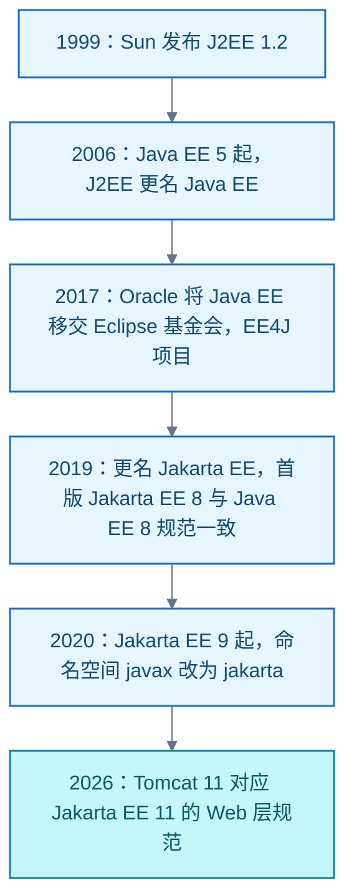

# Java EE 与 Tomcat

**结论**：Java 企业版（Java Platform, Enterprise Edition，Java EE，现 Jakarta EE）是一组规范，不是软件；Tomcat 是实现其中 Web 层子集（Servlet、JSP、EL、WebSocket）的开源 Servlet 容器。完整实现全部规范的软件叫应用服务器（如 GlassFish、WildFly、WebLogic）。Tomcat 听得多而 Java EE 听得少，因为：Tomcat 是可安装运行的具体产品、是 Web 子集的事实标准且被 Spring Boot 默认内嵌；「Java EE」之名已停用，完整平台话题又被 Spring 分流。

名称与归属演变：

Tomcat 与规范版本对应：Tomcat 9 对应 Java EE 8（Servlet 4.0，最后一个支持 `javax` 命名空间的大版本）；Tomcat 10.1 对应 Jakarta EE 10（Servlet 6.0）；Tomcat 11 对应 Jakarta EE 11（Servlet 6.1）。学习方向应按实际工程需求选择。

信源：

- [Apache Tomcat 版本与规范对应（一手）](https://tomcat.apache.org/whichversion.html)
- [Jakarta EE 官网（一手）](https://jakarta.ee/)
- [Jakarta EE About（一手）](https://jakarta.ee/about/)
- [Eclipse Foundation 博客：Java EE Moves to the Eclipse Foundation（一手，2017-09-12）](https://eclipse-foundation.blog/2017/09/12/java-ee-moves-to-the-eclipse-foundation)

<!-- backlinks:start -->

## 引用本页的文章

- [Java](index.md)

<!-- backlinks:end -->
