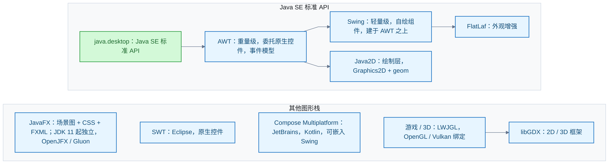

# Java 图形化编程

按层次分四组：官方工具包 AWT、Swing、JavaFX 三代；第三方桌面工具包；绘制层；游戏方向。选型结论：跨平台一致性选 Swing；现代 UI 与 CSS 布局选 JavaFX；原生观感选 SWT；Kotlin 技术栈选 Compose Multiplatform。

**AWT（Abstract Window Toolkit）**：`java.awt` 包。重量级组件：每个组件委托操作系统原生控件。提供事件模型、布局、Java2D 绘制等基础设施。

**Swing**：`javax.swing` 包。轻量级组件：纯 Java 绘制，不依赖原生控件，跨平台表现一致。构建在 AWT 之上；外观可插拔（`plaf` 包：Metal、Nimbus、Synth）。AWT 与 Swing 均在 `java.desktop` 模块中（JDK 25 核实），属 Java SE 标准 API（模块体系见 [JDK：版本演化与类库体系](jdk.md)）。

**JavaFX**：场景图（scene graph）+ CSS + FXML。支持桌面、移动与嵌入式。JavaFX 自 11 起脱离 JDK，不再随 JDK 分发，由 OpenJFX 独立演进（现为 27），经 Maven Central 或 Gluon SDK 获取；许可证为 GPL + 类路径例外，与 OpenJDK 相同。配套工具：Scene Builder（可视化布局）、TestFX（UI 测试）。

**SWT（Standard Widget Toolkit）**：Eclipse Foundation 维护。直接使用操作系统原生 UI 能力，支持 Windows（win32）、macOS（Cocoa）、Linux（GTK）；Maven Central 分发。仍活跃。

**Apache Pivot**：已退役（Apache Attic）。末版 2.0.5（2017-07）。新项目不应选用。

**Compose Multiplatform**：JetBrains 出品，Kotlin 语言，声明式 API（与 Jetpack Compose 同源）。桌面目标（Windows、macOS、Linux）为 Stable；可与 Swing 互操作。

**Java2D**：`java.awt.Graphics2D` 与 `java.awt.geom`。二维绘制 API，属 `java.desktop`。它是绘制层，不是控件工具包。

**LWJGL 3（Lightweight Java Game Library）**：原生图形库绑定（OpenGL、OpenGL ES、Vulkan、GLFW 等）。3.4.0 起支持 FFM API，适配 JDK 25。自定位为底层访问库，不是游戏框架。

**libGDX**：基于 OpenGL (ES) 的 2D/3D 游戏框架。1.14.x（2026-05 发布），社区活跃。同一代码库发布桌面、Android、iOS 与 HTML5。

**FlatLaf**：Swing 现代外观（Look and Feel）。3.x 系列，活跃。被 NetBeans、Ghidra、Burp Suite 等采用。

**选型要点**：

- 必须跨平台一致、零额外依赖：Swing（JDK 自带）。
- 现代 UI、CSS 样式、FXML 分离：JavaFX（另加依赖）。
- 原生观感、Eclipse 生态：SWT。
- Kotlin 技术栈、与 Android 共享代码：Compose Multiplatform。
- 游戏或自绘 3D：LWJGL（要底层）或 libGDX（要框架）。
- 退役项（Apache Pivot）不再考虑。

信源（均一手，核实日期 2026-11-01）：[java.desktop 模块（Java SE 25 API）](https://docs.oracle.com/en/java/javase/25/docs/api/java.desktop/module-summary.html)、[OpenJFX 官网](https://openjfx.io/)、[Eclipse SWT 项目页](https://eclipse.dev/eclipse/swt/)、[Apache Pivot 官网（退役公告）](https://pivot.apache.org/)、[Compose Multiplatform 官网](https://kotlinlang.org/compose-multiplatform/)、[LWJGL 3 仓库](https://github.com/LWJGL/lwjgl3)、[libGDX 官网](https://libgdx.com/)、[FlatLaf 仓库](https://github.com/JFormDesigner/FlatLaf)。

### 证据与时效 · q-20261101-003

- **信源**：[一手] [java.desktop 模块（Java SE 25 API）](https://docs.oracle.com/en/java/javase/25/docs/api/java.desktop/module-summary.html)；[一手] [OpenJFX 官网](https://openjfx.io/)；[一手] [Eclipse SWT 项目页](https://eclipse.dev/eclipse/swt/)；[一手] [Apache Pivot 官网（退役公告）](https://pivot.apache.org/)；[一手] [Compose Multiplatform 官网](https://kotlinlang.org/compose-multiplatform/)；[一手] [LWJGL 3 仓库](https://github.com/LWJGL/lwjgl3)；[一手] [libGDX 官网](https://libgdx.com/)；[一手] [FlatLaf 仓库](https://github.com/JFormDesigner/FlatLaf)。核实日期：2026-11-01。

## 提问记录

### q-20261101-003

- **原题**：2026-11-01 · Java 图形化编程技术有哪些
- **问**：Java 图形化编程技术有哪些？
- **领域**：Java SE
- **首次**：2026-11-01
- **更新**：2026-11-01
- **正文**：[Java 图形化编程](#java-图形化编程)
- **关联**：[2026-09-23 · Java SE 的学习路线与完整知识点](语言与标准库.md#q-20260923-003)；[2026-10-15 · JDK 自身类库体系的宏观概览](jdk.md#q-20261015-003)
