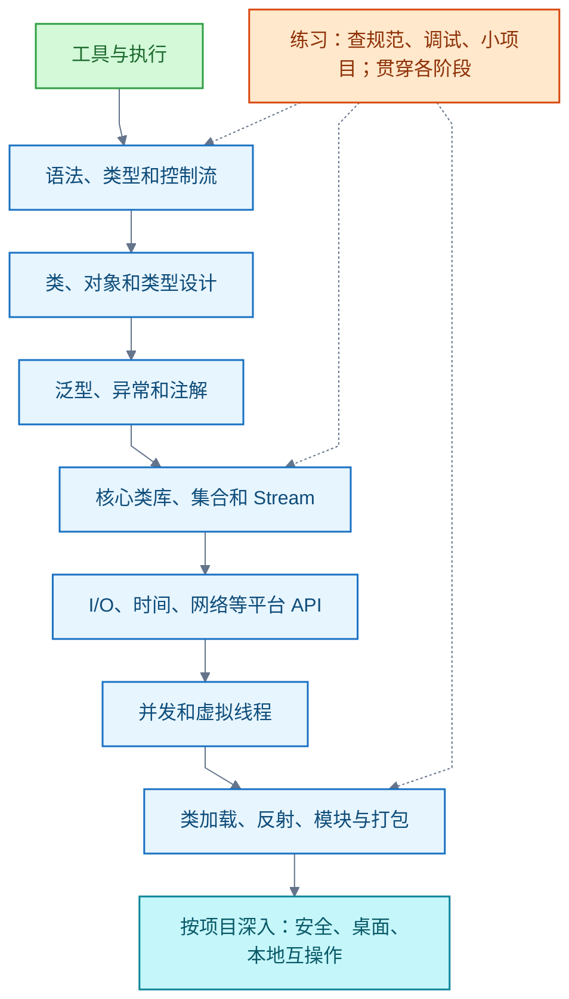

# Java SE：语言与标准库

<!-- domain: Java SE -->
**范围**：Java SE 的语言、标准库、工具链与平台机制学习路线（练习基线随 LTS 演进，现为 JDK 25）及经典书籍与网站、JDK 8→25 差异、JDK 类库体系。

**综述**：Java 标准版（Java Platform, Standard Edition，Java SE）的学习按工具执行、类型与对象、泛型和异常、核心类库、平台 API、并发、模块与打包递进。练习基线在 2026-10-15 从 JDK 21 修正为 JDK 25；语言、类库和运行时的增量按版本核对。dev.java 与官方规范承担现行依据，书籍按教学用途与覆盖版本组合，冻结在 JDK 8 的经典教程需要对照练习基线使用。类库按 Java SE 标准 API 与 JDK 专属 API 理解；模块组织包并声明依赖与导出，包名前缀不能单独判定 API 身份。桌面图形化主线为 AWT → Swing（均在 java.desktop）与 JavaFX（JDK 11 起由 OpenJFX 独立演进），第三方桌面工具包有 SWT 与 Compose Multiplatform，Apache Pivot 已退役。详细清单、书目和演变过程见相关章节与文章末尾的提问记录。
<!-- /domain -->

Java SE 是 Java 语言、类库与运行时的平台。本文是语言与标准库的知识体系与学习路线；[JDK 版本演化与类库体系](jdk.md)与[图形化编程](图形化.md)另见专文。

先掌握语言、对象、泛型、异常、集合和常用 API，再学并发、反射、模块与运行时机制。每阶段以可运行程序和机制解释验收。这条路线依据 Java SE 21 规范与官方学习资料整理，不是官方统一课程。"完整"指知识领域完整；类和方法的清单以 API 文档为准。先用普通 `javac`、`java` 和一个小程序理解运行路径，再引入其他工具；换版本时应重新核对 API 与预览状态。

| 阶段 | 学习重点 | 完成标志 |
| --- | --- | --- |
| 1．工具与执行 | JDK、源文件、编译、启动、调试和文档 | 能从命令行编译、运行、打包并定位简单错误 |
| 2．语言基础 | 类型、变量、表达式、控制流、数组、方法 | 能独立完成命令行程序并解释转换与参数传递 |
| 3．对象与类型设计 | 类、接口、继承、多态、对象契约、现代类型 | 能建立小型模型并说明封装与组合的选择 |
| 4．类型约束与错误处理 | 泛型、异常、资源关闭、注解 | 能设计类型安全的 API，正确传播异常与关闭资源 |
| 5．核心类库与数据处理 | 字符串、数字、集合、Lambda、Stream | 能选择集合并写出可读的数据处理流程 |
| 6．外部数据与平台 API | 文件、字符集、时间、网络、JDBC 等 | 能可靠读取、转换、传输和持久化数据 |
| 7．并发 | 共享状态、任务执行、取消、虚拟线程 | 能说明线程安全条件，控制任务数量和生命周期 |
| 8．运行机制与组织 | 类加载、反射、模块、字节码、打包 | 能解释程序如何加载与运行，诊断依赖和运行问题 |

**1．工具、编译与执行**。用 `jshell` 试验语句；用集成开发环境（Integrated Development Environment，IDE）的断点、单步、调用栈和变量检查调试。程序路径：`.java` 源文件 → `javac` 编译 → `.class` 字节码 → `java` 启动；掌握 `main` 入口、程序参数、系统属性、环境变量、退出码、包名、目录布局、`import` 与类路径（class path）。用 `jar` 制作 Java 归档文件（Java Archive，JAR）并理解清单文件；用 `javadoc` 生成文档、`javap` 查看字节码；后续再用 `jdeps`、`jlink`、`jpackage`、`jdb`、`jcmd`。

**2．语言基础与类型**。源码结构（标识符、字面量、声明、作用域）；八种基本类型、引用类型、`null`、确定赋值、`final`、局部变量类型推断 `var`；数值提升、宽化与窄化转换、溢出、装箱与拆箱。运算覆盖算术、比较、逻辑、位运算、移位与优先级；控制流覆盖 `if`、`switch` 语句与表达式、`for`、增强 `for`、`while`、`do-while`、`break`、`continue`、`return`、`assert`。数组含一维与多维、数组边界；方法含重载、递归、可变参数。Java 参数传递的是**值**；对象参数传递的是引用值。`String` 不可变，配合 `StringBuilder` 与字符串比较；`char` 是 UTF-16 代码单元，处理完整 Unicode 字符时应认识代码点与代理对。

**3．对象模型与现代语言特性**。类与对象：字段、方法、构造器、初始化顺序、实例与 `static` 成员、`this`、`super`、包和四级访问控制。面向对象：封装、继承、多态、抽象类、接口与默认方法；重载、重写、方法隐藏、动态分派、`final`；组合与继承按适用条件选择。类的形态：静态嵌套类、内部类、局部类、匿名类、枚举（`enum`）；记录类（record）、密封类（sealed）、`instanceof` 模式、`switch` 模式和记录模式。对象契约：对象身份与逻辑相等、`equals`、`hashCode`、`toString`、`Comparable`／`Comparator`；可变性、不可变性与防御性复制。

**4．泛型、异常、资源与注解**。泛型（Generics）覆盖泛型类、接口、方法和构造器；上界、通配符、协变读与逆变写、不变性、类型推断、原始类型、类型擦除、桥接方法、可具体化类型、泛型数组限制、堆污染与泛型可变参数。异常区分受检与非受检；掌握 `try`／`catch`／`finally`、多重捕获、异常链与受抑制异常；资源用 `AutoCloseable` 与 `try-with-resources` 关闭。注解（Annotation）：内置注解、自定义 `@interface`、`@Target`、`@Retention`、`@Repeatable`、`@Inherited` 与源码／类文件／运行时保留策略；注解本身不自动执行逻辑；掌握反射读取与编译期注解处理器。

**5．核心类型、集合与函数式处理**。常用类型：`Object`、`Objects`、包装类、`Math`、`BigInteger`、`BigDecimal`、`UUID`、`Optional`、`Arrays`、`Collections`、`RandomGenerator`、`Base64`；区分数值、文本和对象的比较语义。集合框架（Collections Framework）从 `Iterable`、`Iterator`、`Collection` 到 `List`／`Set`／`Queue`／`Deque`／`Map`，加上 `SortedSet`／`NavigableSet`／`SortedMap`／`NavigableMap` 与 JDK 21 的 `SequencedCollection`／`SequencedSet`／`SequencedMap`；常用实现含 `ArrayList`、`LinkedList`、`ArrayDeque`、`PriorityQueue`、`HashSet`、`LinkedHashSet`、`TreeSet`、`HashMap`、`LinkedHashMap`、`TreeMap`、`EnumSet`、`EnumMap`；按遍历、排序、查找、复杂度与键的相等契约选择；可修改集合、不可修改视图和不可变元素分别判断。函数式处理：函数式接口、`java.util.function`、Lambda、方法引用、变量捕获；Stream 掌握数据源、惰性执行、中间与终止操作、`Collector`、基本类型流、并行流与副作用。

**6．文本、时间、文件与外部系统**。文本覆盖 Unicode 代码点、`Charset` 编解码、正则 `Pattern`／`Matcher`、`Locale`、`ResourceBundle` 与数字日期格式化。日期时间用 `java.time`（`Instant`、`LocalDate`、`ZonedDateTime`、`ZoneId` 等）：区分时间点与本地日期时间，掌握时区规则与 `Duration`／`Period`；旧版 `Date`／`Calendar` 只作互操作。输入/输出（Input/Output，I/O）先掌握 `Path`／`Files` 与目录元数据，再学字节流与字符流、缓冲、`ByteBuffer`、`Channel`、`Selector` 与阻塞／非阻塞 I/O；注意对象序列化的格式兼容性与反序列化风险。网络含 `URI`、`InetAddress`、`Socket`、`ServerSocket`、`DatagramSocket`、`HttpClient`、WebSocket 客户端与传输层安全协议（Transport Layer Security，TLS）的超时与字符集用法。数据库走 Java 数据库连接（Java Database Connectivity，JDBC）：`DataSource`、`Connection`、`PreparedStatement`、`ResultSet`、事务与资源关闭；另有 `java.util.logging` 与 `java.xml` 的 DOM、SAX、StAX、JAXP。

**7．并发与线程模型**。基本语义：`Thread`、`Runnable`、`Callable`、线程状态、启动与结束、`join`、中断、取消、超时；竞态、死锁、活锁和饥饿。正确性：`synchronized`、`volatile`、`wait`／`notify`；按 Java 内存模型（Java Memory Model，JMM）理解可见性、原子性、有序性与 happens-before；安全发布、不可变对象、`final` 字段语义。并发工具：`Lock`／`Condition`、原子类与比较并交换（Compare-and-Set，CAS）、`VarHandle`、`ExecutorService` 与线程池、任务队列和拒绝策略、`Future`、`CompletableFuture`、`ForkJoinPool`、`ConcurrentHashMap` 与并发队列、`Semaphore`、`CountDownLatch`、`ThreadLocal`；深入时再读 `LockSupport`、`AbstractQueuedSynchronizer` 与 `Flow` 的发布订阅和背压。虚拟线程（Virtual Thread）JDK 21 正式提供：掌握任务生命周期、中断、阻塞 I/O、资源上限和线程局部变量的成本；适合大量等待 I/O 的任务，**不能**提高 CPU 密集计算的吞吐能力。

**8．类加载、反射、模块与 JVM 基础**。掌握类加载、链接、初始化、类加载器与类身份；虚拟机栈、堆、垃圾回收的基本职责；规范语义与 HotSpot 实现细节分开学习（GC、JIT 与诊断属 JVM 领域，见 [JVM](../jvm.md)）。反射含动态代理、`InvocationHandler`、`MethodHandle` 与模块开放边界。代码组织：Java 平台模块系统（Java Platform Module System，JPMS）的 `requires`、`exports`、`opens`、`uses`、`provides`；`ServiceLoader` 与服务提供者接口（Service Provider Interface，SPI）；用 `jdeps` 查依赖、`jlink` 定制运行时、`jpackage` 打包。

**9．按应用需要深入**。安全与密码：`java.security`、`javax.crypto` 的证书、`KeyStore`、`SecureRandom`、`MessageDigest`、`Mac`、`Signature`、`Cipher`、安全提供者与 TLS；先掌握算法、密钥和参数的协议要求，再查具体 API 契约。桌面与系统集成：`java.desktop` 的 AWT／Swing（见 [图形化](图形化.md)）、JavaBeans、音频、图像、打印与无障碍接口；`java.datatransfer`、Java 管理扩展（Java Management Extensions，JMX）与 `java.management.rmi`、`java.instrument` 代理、`java.naming` 的 JNDI、`java.rmi`、`java.prefs`，按场景选学。其他 Java SE 模块：`java.compiler` 的语言模型与注解处理接口、`java.scripting`、`java.sql.rowset`、`java.transaction.xa`、`java.se` 聚合模块；模块清单以 API 概览为准。本地互操作有 Java 本地接口（Java Native Interface，JNI）和外部函数与内存 API（Foreign Function and Memory API，FFM）；FFM 在 JDK 21 属预览 API，使用前核对版本文档；普通 Java SE 学习可放在最后。

**JDK 21 版本节点**。正式特性：记录模式与 `switch` 模式匹配（21 转正）、顺序集合、虚拟线程；`record`、密封类、文本块、`switch` 表达式在早期版本已转正。预览特性：字符串模板、未命名模式与变量、未命名类和实例 `main` 方法——不要把预览语法当成跨版本稳定基础。

**修正：练习基线选 21 还是 25**（2026-10-15 追问）。

- 旧结论（保留）：JDK 21 是本路线的练习基线（2026-09-23）。
- 新结论：新学习者直接以 **JDK 25** 为练习基线。JDK 25 于 2025-09-16 GA，是当前长期支持（Long-Term Support，LTS）版本；JDK 27 于 2026-09-15 GA 但未被标注为 LTS，按 17→21→25 的两年 LTS 节奏，25 仍是当前 LTS。八个阶段与知识领域不变，只把"按 21 版文档核对"替换为"按 25 版文档核对"。
- JDK 25 已核实增量：转正——模块导入声明（JEP 511）、紧凑源文件与实例 `main` 方法（JEP 512；21 中为预览，25 起可正常使用）、灵活构造器体（JEP 513）、Scoped Values（JEP 506）；仍为预览——结构化并发（JEP 505，第五轮）、原始类型模式匹配（JEP 507，第三轮）、Stable Values（JEP 502），预览特性仍不作稳定基础。VM 层另有紧凑对象头（JEP 519）与 AOT 类加载（JEP 514／515）等性能项，不影响语言学习。
- 教材不换：Core Java 13（Java 21）、On Java（Java 8）等在 25 上直接编译运行；两个 LTS 间语言与平台主体完全一致。

**练习链与总验收**。练习链：命令行小程序 → 带 `record`／接口／泛型的领域模型 → 集合与 Stream 数据汇总 → 带字符集和时区处理的文件工具 → 有超时与取消的并发任务 → JAR／模块打包并用 `javap`、`jdeps` 检查。总验收：能解释类型转换、相等契约、集合选择、泛型边界、异常传播、资源关闭、时间语义、线程安全和类加载；能用官方 API 文档确认未记住的具体行为。

信源（均一手，核实日期 2026-09-23 与 2026-10-15）：[Java SE 21 与 JDK 21 规范目录](https://docs.oracle.com/en/java/javase/21/docs/specs/)、[Java SE 21 API 文档](https://docs.oracle.com/en/java/javase/21/docs/api/index.html)、[JDK 21 工具规范](https://docs.oracle.com/en/java/javase/21/docs/specs/man/index.html)、[Dev.java 学习目录](https://dev.java/learn/)、[Java SE 21 语言特性状态](https://docs.oracle.com/en/java/javase/21/language/java-language-changes-summary.html)、[JDK 25 项目页](https://openjdk.org/projects/jdk/25/)、[JDK 27 项目页](https://openjdk.org/projects/jdk/27/)、[JEP 索引](https://openjdk.org/jeps/0)。

### 范围与学习顺序

**初版范围（2026-09-23；练习基线已于 2026-10-15 修正）**：以 Java 语言规范、Java SE 21 API、Java 虚拟机规范及 JDK 21 工具文档确定范围。这里的“完整”指**知识领域完整**；每个类和方法的清单以 [Java SE 21 API 文档](https://docs.oracle.com/en/java/javase/21/docs/api/index.html) 为准。先用普通 `javac`、`java` 和一个小程序理解运行路径，再逐步引入其他工具。初版以 JDK 21 为练习基线；现按上述修正使用 JDK 25。换用其他版本时，应重新核对 API 和预览状态。

### 语言与标准库查阅点

- **类与对象**：字段、方法、构造器、初始化顺序、实例成员与 `static` 成员、`this`、`super`、包和四级访问控制。
- **面向对象**：封装、继承、多态、抽象类、接口与默认方法；重载、重写、方法隐藏、动态分派、`final`；组合与继承的适用条件。
- **类的形态**：静态嵌套类、内部类、局部类、匿名类、枚举（`enum`）；记录类（`record`）、密封类（`sealed`）、`instanceof` 模式、`switch` 模式和记录模式。
- **对象契约**：对象身份与逻辑相等；`Object.equals`、`hashCode`、`toString`；`Comparable`、`Comparator`；可变性、不可变性与防御性复制。类与对象的基础见 [官方教程](https://dev.java/learn/classes-objects/)。

- **泛型（Generics）**：泛型类、接口、方法和构造器；上界、通配符、协变读与逆变写、不变性、类型推断；原始类型、类型擦除、桥接方法、可具体化类型、泛型数组限制、堆污染与泛型可变参数。
- **异常（Exception）**：`Throwable`、`Error`、受检异常与非受检异常；`throw`、`throws`、`try`、`catch`、`finally`、多重捕获、异常链与受抑制异常；自定义异常和异常边界。文件等资源用 `AutoCloseable` 与 `try-with-resources` 管理。[异常教程](https://dev.java/learn/exceptions/)说明语言要求。
- **注解（Annotation）**：`@Override`、`@Deprecated` 等内置注解；自定义 `@interface`、元素、`@Target`、`@Retention`、`@Repeatable`、`@Inherited`；源码、类文件与运行时保留策略；反射读取、编译期注解处理器和生成代码。注解本身不自动执行逻辑。[注解教程](https://dev.java/learn/annotations/)给出用途与限制。

- **常用类型**：`Object`、`Objects`、包装类、`Math`、`BigInteger`、`BigDecimal`、`UUID`、`Optional`、`Arrays`、`Collections`、`RandomGenerator`、`Base64`；区分数值、文本和对象的比较语义。
- **集合框架（Collections Framework）**：`Iterable`、`Iterator`、`Collection`、`List`、`Set`、`Queue`、`Deque`、`Map`；`SortedSet`、`NavigableSet`、`SortedMap`、`NavigableMap`；JDK 21 的 `SequencedCollection`、`SequencedSet`、`SequencedMap`。
- **常用实现与选择**：`ArrayList`、`LinkedList`、`ArrayDeque`、`PriorityQueue`、`HashSet`、`LinkedHashSet`、`TreeSet`、`HashMap`、`LinkedHashMap`、`TreeMap`、`EnumSet`、`EnumMap`；遍历、排序、查找、散列、顺序、复杂度、键的相等契约；可修改集合、不可修改视图和不可变元素分别判断。[集合教程](https://dev.java/learn/api/collections-framework/)与 [JDK 21 顺序集合说明](https://docs.oracle.com/en/java/javase/21/core/creating-sequenced-collections-sets-and-maps.html)是核对依据。
- **函数式处理**：函数式接口、`java.util.function`、Lambda、方法引用、变量捕获；`Stream` 的数据源、中间操作、终止操作与惰性执行；`map`、`filter`、`flatMap`、`reduce`、`collect`、`Collector`、基本类型流、`Optional`、并行流与副作用。[Stream 教程](https://dev.java/learn/api/streams/)按这些主题展开。

- **文本和国际化**：Unicode 代码点、UTF-8 等字符集、编码与解码、`Charset`；正则表达式 `Pattern` / `Matcher`；`Locale`、`ResourceBundle`、数字与日期格式化。
- **日期时间**：`Instant`、`LocalDate`、`LocalTime`、`LocalDateTime`、`OffsetDateTime`、`ZonedDateTime`、`ZoneId`；时间点与本地日期时间的区别、时区规则、`Duration`、`Period`、解析与格式化；旧版 `Date` / `Calendar` 的互操作。[日期时间教程](https://dev.java/learn/date-time/)按类型逐项讲解。
- **输入/输出（Input/Output，I/O）**：字节流与字符流、缓冲、标准输入输出、`Path` 与 `Files`、目录和元数据；`ByteBuffer`、`Channel`、`Selector`，阻塞与非阻塞 I/O；对象序列化的格式、兼容性与反序列化风险。日常文件操作先掌握 `Path` / `Files`。[I/O 教程](https://dev.java/learn/java-io/)提供学习顺序。
- **网络与 HTTP**：`URI`、`InetAddress`、`Socket`、`ServerSocket`、`DatagramSocket`、`HttpClient`、WebSocket 客户端；请求与响应、连接、超时、字符集和传输层安全协议（Transport Layer Security，TLS）的 API 使用。
- **数据库与其他平台接口**：Java 数据库连接（Java Database Connectivity，JDBC）的 `DataSource`、`Connection`、`PreparedStatement`、`ResultSet`、事务与资源关闭；`java.util.logging`；`java.xml` 的 DOM、SAX、StAX 与 JAXP。按实际项目选择深度，先会查对应模块的 API 文档。

- **运行机制**：class 文件、字节码、验证、类加载、链接、初始化、类加载器与类身份；虚拟机栈、堆、垃圾回收的基本职责；规范规定的语义与 HotSpot 实现细节分开学习。深入 GC、JIT 和诊断接续 [2026-09-23 · JVM 的系统学习路线与知识地图](../jvm.md#q-20260923-002)。
- **反射与动态调用**：`Class`、`Field`、`Method`、`Constructor`、动态代理、`InvocationHandler`、`MethodHandle`；访问控制、模块开放、反射的适用边界。[反射教程](https://dev.java/learn/reflection/)建议在语言基础之后学习。
- **代码组织**：包、JAR、类路径、模块路径、Java 平台模块系统（Java Platform Module System，JPMS）；`module-info.java` 的 `requires`、`exports`、`opens`、`uses`、`provides`；`ServiceLoader` 与服务提供者接口（Service Provider Interface，SPI）。用 `jdeps` 查依赖、`jlink` 定制运行时、`jpackage` 打包应用。[模块教程](https://dev.java/learn/modules/)讲清了类路径与模块路径的关系。

- **安全与密码**：`java.security`、`javax.crypto`、证书 API、`KeyStore`、`SecureRandom`、`MessageDigest`、`Mac`、`Signature`、`Cipher`、安全提供者与 TLS；按需查 `java.security.jgss`、`java.security.sasl`、`java.smartcardio`、`java.xml.crypto`。先掌握算法、密钥和参数的协议要求，再查具体 API 契约。
- **桌面与系统集成**：`java.desktop` 的 AWT / Swing、JavaBeans、音频、图像、打印与无障碍接口；`java.datatransfer` 的数据传输；`java.management` 的 Java 管理扩展（Java Management Extensions，JMX）与 `java.management.rmi`；`java.instrument` 代理；`java.naming` 的 JNDI、`java.rmi`、`java.prefs`。按使用场景选学。
- **其他 Java SE 模块**：`java.compiler` 的语言模型、编译器与注解处理接口；`java.scripting` 脚本接口；`java.sql.rowset`、`java.transaction.xa` 的数据库扩展；`java.se` 聚合模块。模块清单及边界以 [Java SE 21 API 概览](https://docs.oracle.com/en/java/javase/21/docs/api/index.html) 为准。
- **本地互操作**：Java 本地接口（Java Native Interface，JNI）和外部函数与内存 API（Foreign Function and Memory API，FFM）。FFM 在 JDK 21 属[预览 API](https://docs.oracle.com/en/java/javase/21/docs/api/java.base/java/lang/foreign/package-summary.html)，使用前核对版本文档；普通 Java SE 学习可放在最后。

- **源码结构**：标识符、关键字、字面量、注释、声明、表达式、语句、代码块与作用域。

- **数组与方法**：一维和多维数组、数组边界、方法声明与调用、重载、返回值、递归、可变参数；Java 参数传递的是**值**，对象参数传递的是引用值。

- **文本基础**：`String` 不可变性、`StringBuilder`、字符串比较；`char` 是 UTF-16 代码单元，处理完整 Unicode 字符时应认识代码点与代理对。基础语法以 [语言基础教程](https://dev.java/learn/language-basics/) 和语言规范核对。

- **正式特性**：`record`、密封类、文本块和 `switch` 表达式已在早期版本转正；JDK 21 的记录模式与 `switch` 模式匹配是正式语言特性，顺序集合与虚拟线程也在 JDK 21 正式提供。**预览特性**：例如 JDK 21 的字符串模板、未命名模式与变量、未命名类和实例 `main` 方法；不要把预览语法当成跨版本稳定基础。[语言状态表](https://docs.oracle.com/en/java/javase/21/language/java-language-changes-summary.html)、[顺序集合说明](https://docs.oracle.com/en/java/javase/21/core/creating-sequenced-collections-sets-and-maps.html)、[JEP 444](https://openjdk.org/jeps/444)分别支持这些判断。

- **教材不换**：Core Java 13（Java 21）、On Java（Java 8）等在 25 上直接编译运行；语言与平台主体（类型、对象模型、泛型、集合、Stream、并发基础、IO、模块）两个 LTS 间完全一致。

### 证据与时效 · q-20260923-003

- **信源**：[一手] [Java SE 21 与 JDK 21 规范目录](https://docs.oracle.com/en/java/javase/21/docs/specs/)；[Java SE 21 API 文档](https://docs.oracle.com/en/java/javase/21/docs/api/index.html)；[JDK 21 工具规范](https://docs.oracle.com/en/java/javase/21/docs/specs/man/index.html)；[Dev.java 学习目录](https://dev.java/learn/)；[Java SE 21 语言特性状态](https://docs.oracle.com/en/java/javase/21/language/java-language-changes-summary.html)。核实日期：2026-09-23。
- **信源**：[一手] [JDK 25 项目页（GA 2025-09-16，LTS）](https://openjdk.org/projects/jdk/25/)；[JDK 27 项目页（GA 2026-09-15，未标注 LTS）](https://openjdk.org/projects/jdk/27/)；[JEP 索引（JDK 25 JEP 清单与状态）](https://openjdk.org/jeps/0)。核实日期：2026-10-15。
- 原记录资料（未在迁移时复核）：[语言基础教程](https://dev.java/learn/language-basics/)
- 原记录资料（未在迁移时复核）：[JEP 444](https://openjdk.org/jeps/444)

## 提问记录

### q-20260923-003

- **原题**：2026-09-23 · Java SE 的学习路线与完整知识点
- **问**：整理 javaSE的学习路线，以及涉及的全部知识点。
- **领域**：Java SE
- **首次**：2026-09-23
- **更新**：2026-10-15
- **正文**：[Java SE：语言与标准库](#java-se语言与标准库)
- **关联**：[2026-09-22 · 成为 Java 专家的完整学习路线](../index.md#q-20260922-001)；[2026-10-15 · JDK 25 支持现状（Spring 各线）](../spring.md#q-20261015-004)
