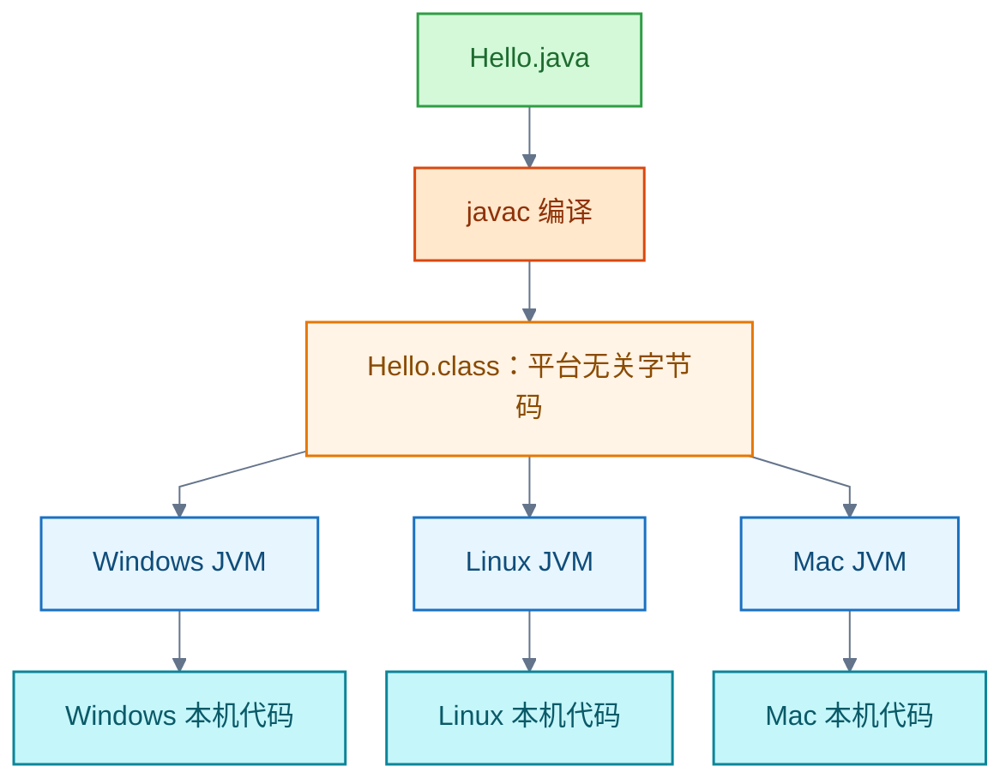
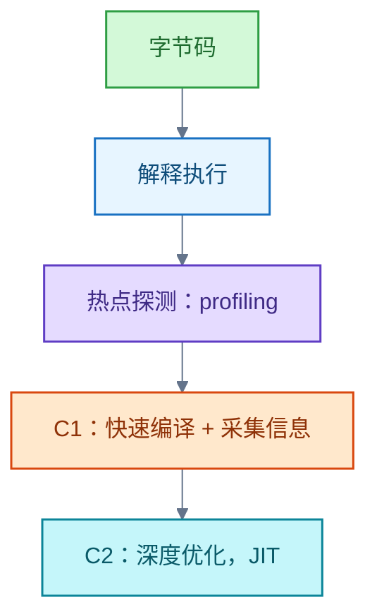

# JVM

JVM 知识合并两条主线：系统学习路线，与 Oracle 教程「跨平台 + 运行时优化」原文的解释。

本节合并两条记录：JVM 的系统学习路线，以及 Oracle 教程中「跨平台 + 运行时优化」原文的解释。

## 跨平台与 HotSpot 运行时优化

Oracle 教程对 Java 技术的说明讲两层机制。跨平台：javac 把源码编译为平台无关的字节码（bytecode），各操作系统各自移植 Java 虚拟机（Java Virtual Machine，JVM），把同一份字节码翻译为本机代码；前提是目标系统装有对应 JVM，代价是比直接执行本机代码多一层翻译。

HotSpot 运行时优化：「查找性能瓶颈」即运行时性能分析（profiling），「重新编译为本机代码」即 JIT。不在编译期全部编译为本机码，是为了保住跨平台，并利用只有运行时才有的信息（热点、类型分布）。HotSpot 用分层编译：C1 快速编译并采集信息，C2 据此深度优化。教程以「一些虚拟机」限定，因为 JIT 属实现行为，JVM 规范将指令优化留给实现。

### 证据与时效 · q-20261029-001

- **信源**：[一手] [Oracle Java Tutorials：About the Java Technology](https://docs.oracle.com/javase/tutorial/getStarted/intro/definition.html)（所引原文出处，核实日期：2026-10-29）；[一手] [JDK 21：HotSpot 性能增强](https://docs.oracle.com/en/java/javase/21/vm/java-hotspot-virtual-machine-performance-enhancements.html)（性能分析与分层编译，核实日期：2026-10-29）。

## 规范与实现的边界

类文件、运行时语义和内存模型由规范定义；内存物理布局、GC 算法及 JIT 优化属于具体实现。前置：会用 Java SE 编写多线程程序，理解进程、线程、虚拟内存、CPU 缓存和基本数据结构。实验以 JDK 21 为主，规范查对应版本；Java SE 27 规范用于核对最新术语，跨版本比较时核查行为和参数。

学习路线（面向 Java 服务端开发）：

| 阶段 | 为什么先学这一层 | 最小实验与通过标准 |
| --- | --- | --- |
| 1．字节码与类文件 | 建立「源码如何成为可执行输入」的模型 | 用 `javac`、`javap -c -v` 对照循环、异常、Lambda、`synchronized`；说明常量池、栈帧和调用指令的作用 |
| 2．类加载与运行时 | 弄清类何时可用、对象和方法在哪里运行 | 写两个类加载器加载同名类；解释类身份、初始化顺序与失败 |
| 3．内存与 GC | 先识别「谁还活着」，再研究回收器 | 制造对象滞留和小堆压力；区分分配过快、存活对象过多与非堆内存增长 |
| 4．编译与并发 | 理解执行速度与可见性为何变化 | 用 JFR 观察热点、分配和锁；用并发小程序证明 happens-before；解释预热、内联、反优化、平台线程和虚拟线程 |
| 5．诊断与调优 | 把模型用于实际服务，而非记参数 | 对 CPU 高、延迟升高、内存增长、线程阻塞各做一次复现实验，保留完整证据链 |
| 6．实现专项（选学） | 按工作问题深入某个实现机制 | 选 GC、编译器、类加载/Agent 或 Native 接口；读 OpenJDK 源码并用实验说明适用 JDK 与实现 |

核心知识主题：JDK/JRE/JVM/规范与 HotSpot 的关系；类文件结构与校验；指令集与五种调用指令；类生命周期（加载→验证/准备/解析→初始化）；运行时数据区（pc、栈、堆、方法区）与各类 `OutOfMemoryError` 的区别；对象可达性与四种引用；GC 算法与 Serial、Parallel、G1、ZGC 的取舍；解释执行、分层编译与代码缓存；JMM（happens-before、数据竞争）与 `synchronized`/`volatile`/`final`/`VarHandle`；Java 堆、直接内存、线程栈与本机内存的系统边界；`-Xlog`、`jcmd`、JFR、线程/堆转储等观测手段。

## 关键边界

- JVM 规范的「方法区」是逻辑区域；HotSpot 元空间是实现中的类元数据存储，两者不能直接等同。JMM 约束多线程可观察行为，不是「堆和栈的分区图」。
- JVMS 第 5 章将 `static` 字段的默认值赋予准备阶段，将 `ConstantValue` 赋值与 `<clinit>` 放在初始化阶段；不要把口诀当成规范。[一手：JVMS §5.4.2、§5.5](https://docs.oracle.com/javase/specs/jvms/se27/html/jvms-5.html)。
- GC 与诊断参数要按 JDK 版本核对；例如 JDK 21 的分代 ZGC 参数不能直接照搬到 JDK 25（版本差异见 [JDK：版本演化与类库体系](java-se/jdk.md)）。

最小综合练习：在测试环境给同一个小型 Java 服务制造对象滞留、频繁分配、锁竞争及大量类加载四种现象；每次只改变一个条件；采集 GC 日志、JFR 与相应转储；写出「现象 → 证据 → 原因 → 调整 → 复测」，并记录 JDK、GC、堆参数、负载和测量窗口。只有当复测显示目标指标改善，才把调整视为有效。

信源：

- [Oracle Java Tutorials：About the Java Technology（一手，所引原文出处）](https://docs.oracle.com/javase/tutorial/getStarted/intro/definition.html)
- [JDK 21：HotSpot 性能增强（一手）](https://docs.oracle.com/en/java/javase/21/vm/java-hotspot-virtual-machine-performance-enhancements.html)
- [Java SE 27 JVM 规范（一手）](https://docs.oracle.com/javase/specs/jvms/se27/html/index.html)
- [Java SE 27 语言规范：线程与锁（一手）](https://docs.oracle.com/javase/specs/jls/se27/html/jls-17.html)
- [JDK 21 HotSpot GC 指南（一手）](https://docs.oracle.com/en/java/javase/21/gctuning/)
- [JDK 21 虚拟机指南（一手）](https://docs.oracle.com/en/java/javase/21/vm/)
- [JDK 21 诊断工具（一手）](https://docs.oracle.com/en/java/javase/21/troubleshoot/diagnostic-tools.html)

### 知识点总表

“核心”指能解释机制并诊断常见生产问题；“深入”指进入 JVM 专项时再学习。指令、属性和 `-XX` 参数按家族理解，遇到问题查对应版本文档，不要求背全表。

| 主题 | 核心知识点 | 深入知识点及一手依据 |
| --- | --- | --- |
| 边界与版本 | JDK、JRE、JVM、Java SE 规范与 HotSpot 的关系；JDK 版本、发行版、启动参数和默认值的适用范围 | JVMS 将物理布局、GC 和指令优化留给实现。[JVMS §2.13](https://docs.oracle.com/javase/specs/jvms/se27/html/jvms-2.html) |
| 类文件 | `ClassFile` 结构、版本、常量池、符号引用、名称与描述符、字段/方法、`Code`、异常表、`StackMapTable`、字节码校验 | `BootstrapMethods`、`MethodHandle`、`invokedynamic`、动态常量、注解、模块及现代属性；二进制兼容。[JVMS 第 4 章](https://docs.oracle.com/javase/specs/jvms/se27/html/jvms-4.html)、[JLS 第 13 章](https://docs.oracle.com/javase/specs/jls/se27/html/jls-13.html) |
| 指令与调用 | 局部变量表、操作数栈；常量、加载/存储、算术/转换、对象/数组、分支、字段访问、方法调用、返回、异常、监视器各类指令；动态分派 | 五种调用指令及解析/选择规则，`invokedynamic` 调用点；按单条指令语义查证。[JVMS 第 2、6 章](https://docs.oracle.com/javase/specs/jvms/se27/html/jvms-2.html)、[指令集](https://docs.oracle.com/javase/specs/jvms/se27/html/jvms-6.html) |
| 类生命周期 | 启动、加载器和类身份；加载→验证/准备/解析→初始化；`<clinit>`、访问控制、父类初始化、初始化失败、类卸载 | 加载约束、模块层、自定义加载器、延迟解析、类加载泄漏、CDS。[JVMS 第 5 章](https://docs.oracle.com/javase/specs/jvms/se27/html/jvms-5.html)、[CDS](https://docs.oracle.com/en/java/javase/21/vm/class-data-sharing.html) |
| 运行时数据区 | `pc`、JVM 栈、栈帧、堆、方法区、运行时常量池、本地方法栈；`StackOverflowError` 与各类 `OutOfMemoryError` 的区别 | HotSpot 元空间、压缩类空间、代码缓存、线程栈及本机内存；方法区是规范概念，不能直接等同于元空间。[JVMS §2.5](https://docs.oracle.com/javase/specs/jvms/se27/html/jvms-2.html)、[内存泄漏排查](https://docs.oracle.com/en/java/javase/21/troubleshoot/troubleshooting-memory-leaks.html) |
| 对象与引用 | 分配与可达性、GC Roots、强/软/弱/虚引用、`ReferenceQueue`、`Cleaner`；对象滞留与内存泄漏 | 对象布局、压缩引用、线程本地分配缓冲区、直接内存和本机内存；布局随实现/版本变化。[引用 API](https://docs.oracle.com/en/java/javase/21/docs/api/java.base/java/lang/ref/package-summary.html)、[HotSpot 优化](https://docs.oracle.com/en/java/javase/21/vm/java-hotspot-virtual-machine-performance-enhancements.html) |
| GC | 标记、清除、复制、压缩；分代假说、并行/并发、停顿；分配率、存活集、吞吐量和停顿；Serial、Parallel、G1、ZGC 的目标与取舍 | G1 的 Region、Remembered Set、写屏障、混合回收；ZGC 的并发机制；安全点、类卸载、碎片与大对象。先用默认设置建立基线，再按目标调节。[JDK 21 GC 指南](https://docs.oracle.com/en/java/javase/21/gctuning/)、[JDK 27 回收器列表](https://docs.oracle.com/en/java/javase/27/gctuning/available-collectors.html) |
| 执行与 JIT | 解释执行、热点探测、分层编译、C1/C2、即时编译（Just-In-Time Compilation，JIT）、预热、内联、栈上替换、反优化、代码缓存 | 逃逸分析、标量替换、锁消除、编译器指令与机器码观察、基准测试陷阱。[HotSpot 性能增强](https://docs.oracle.com/en/java/javase/21/vm/java-hotspot-virtual-machine-performance-enhancements.html) |
| 并发语义 | Java 内存模型（Java Memory Model，JMM）；同步顺序、happens-before、数据竞争；`synchronized`、`volatile`、`final`、`wait/notify`、中断、原子类、`VarHandle` | 锁实现、安全点、平台线程与虚拟线程的调度和诊断；区分内存模型与运行时内存区域。[JLS 第 17 章](https://docs.oracle.com/javase/specs/jls/se27/html/jls-17.html)、[JDK 21 虚拟线程](https://docs.oracle.com/en/java/javase/21/core/virtual-threads.html) |
| 系统边界 | Java 堆、直接内存、线程栈、本机内存、进程驻留内存的关系；CPU、文件、网络及容器资源限制对服务的影响 | JNI、Foreign Function & Memory API、JVMTI、Agent、操作系统采样及崩溃文件分析；NMT 不覆盖第三方本机分配。[NMT](https://docs.oracle.com/en/java/javase/21/vm/native-memory-tracking.html)、[JVMTI](https://docs.oracle.com/en/java/javase/25/docs/specs/jvmti.html)、[Java Agent API](https://docs.oracle.com/en/java/javase/21/docs/api/java.instrument/java/lang/instrument/package-summary.html)、[Foreign Function & Memory API](https://docs.oracle.com/en/java/javase/25/core/foreign-function-and-memory-api.html) |
| 观测与故障 | `-Xlog` 统一日志；`jcmd` 的 `VM.flags`、`GC.heap_info`、`GC.class_histogram`、`GC.heap_dump`、`Thread.print`、`JFR.start`；JFR、JMC、`jfr`、线程/堆转储；CPU、吞吐量、延迟分位数、GC 停顿和内存趋势 | NMT 基线与差分；`jstat`、`jstack`、`jmap`、`jhsdb` 的适用条件和风险；JFR 自定义事件。堆转储可能高影响，诊断工具应与目标 JDK 版本匹配。[诊断工具](https://docs.oracle.com/en/java/javase/21/troubleshoot/diagnostic-tools.html)、[`jcmd` 手册](https://docs.oracle.com/en/java/javase/25/docs/specs/man/jcmd.html)、[`java` 手册](https://docs.oracle.com/en/java/javase/25/docs/specs/man/java.html) |

### 证据与时效 · q-20260923-002

- **信源**：[一手] [Java SE 27 JVM 规范](https://docs.oracle.com/javase/specs/jvms/se27/html/index.html)；[Java SE 27 语言规范第 17 章](https://docs.oracle.com/javase/specs/jls/se27/html/jls-17.html)；[JDK 21 HotSpot GC 指南](https://docs.oracle.com/en/java/javase/21/gctuning/)；[JDK 21 虚拟机指南](https://docs.oracle.com/en/java/javase/21/vm/)；[JDK 21 诊断工具](https://docs.oracle.com/en/java/javase/21/troubleshoot/diagnostic-tools.html)。核实日期：2026-09-23。
- 原记录资料（未在迁移时复核）：[G1 调优建议](https://docs.oracle.com/en/java/javase/21/gctuning/garbage-first-garbage-collector-tuning.html)
- 原记录资料（未在迁移时复核）：[JDK 25 GC 指南](https://docs.oracle.com/en/java/javase/25/gctuning/)
- 原记录资料（未在迁移时复核）：[Java SE 21 JVM 规范](https://docs.oracle.com/javase/specs/jvms/se21/html/index.html)
- 原记录资料（未在迁移时复核）：[Java SE 支持路线图](https://www.oracle.com/java/technologies/java-se-support-roadmap.html)

## 提问记录

### q-20260923-002

- **原题**：2026-09-23 · JVM 的系统学习路线与知识地图
- **问**：制定 JVM 的学习路线，以及需要掌握的全部知识点。
- **领域**：Java
- **首次**：2026-09-23
- **更新**：2026-09-23
- **正文**：[JVM](#jvm)

### q-20261029-001

- **原题**：2026-10-29 · JVM 跨平台与 HotSpot 运行时优化的机制
- **问**：解释 Oracle 教程原文：JVM 可运行于多种操作系统，同一 .class 文件能在 Windows、Solaris OS、Linux、Mac OS 上运行；HotSpot 等虚拟机在运行时执行额外步骤提升性能，包括查找性能瓶颈、将频繁使用的代码段重新编译为本机代码。
- **领域**：Java
- **首次**：2026-10-29
- **更新**：2026-10-29
- **正文**：[跨平台与 HotSpot 运行时优化](#跨平台与-hotspot-运行时优化)
- **关联**：[2026-09-23 · JVM 的系统学习路线与知识地图](jvm.md#q-20260923-002)
