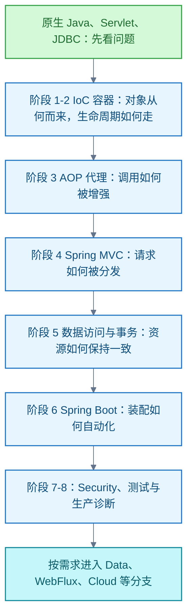
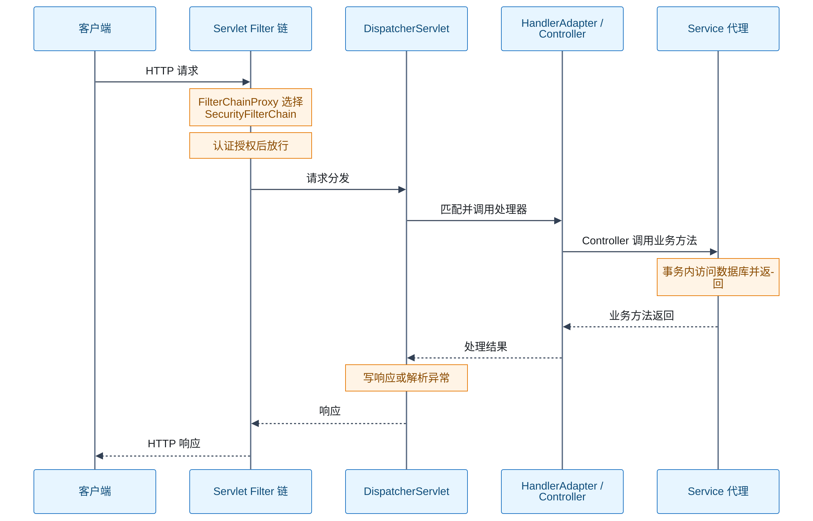

# Spring

以 Spring Framework 为机制主线：先在原生 Java、Servlet、JDBC 中认识装配、横切与事务问题，再学容器、代理、MVC 与数据访问，由 Spring Boot 组织；Security 与测试入主线，其余按需分支。

## Spring 的学习路线与知识地图

**结论**：以 Spring Framework 的容器、代理、Web 与事务为核心，按「问题动机 → 最小实现 → 框架抽象 → 源码调用链 → 故障实验」的顺序学习。Spring Boot、Security 和测试进入主线，其他 Spring 项目按场景扩展。「全部」指主要机制及现代服务端工程知识地图，不指每个项目、类和注解的穷举。此路线是基于官方资料的教学编排，并非 Spring 官方课程。

### 为什么形成这套框架

Spring 官方把起点追溯到对早期 J2EE 复杂性的回应：

- **容器**把对象创建和装配从业务代码移到配置模型。
- **代理**让事务等横切逻辑围绕方法调用组合。
- **MVC** 将 Servlet 请求处理拆成可替换组件。
- **Spring Boot** 后来用约定和条件配置缩短启动与部署路径。

这是对官方历史与设计原则的教学归纳，不表示每层抽象都适合每个项目。见 [Spring 历史与设计原则（一手）](https://docs.spring.io/spring-framework/reference/overview.html)、[Boot 目标（一手）](https://docs.spring.io/spring-boot/)。

### 分工与前置

- **Spring Framework** 提供控制反转（Inversion of Control，IoC）容器、面向切面编程（Aspect-Oriented Programming，AOP）、事务、Web MVC / WebFlux、测试和集成抽象；**Spring Boot** 负责应用启动、自动配置、依赖管理与生产支持；**Spring Data、Security、Cloud 等**是独立项目。先掌握 Framework，才能解释 Boot 和其他项目的行为。见 [Framework 目录（一手）](https://docs.spring.io/spring-framework/reference/)、[项目目录（一手）](https://spring.io/projects)。
- 前置知识：[Java SE](java-se/语言与标准库.md) 的反射、注解、泛型、异常、并发；Maven 或 Gradle；HTTP、Servlet / Filter；SQL、JDBC、数据库事务；JUnit。先能写出不依赖 Spring 的小型服务，再观察 Spring 消除了哪些重复工作。
- 固定一个项目版本做实验，再查该版本文档。进入 Spring Cloud 时，必须核对其发布列车与 Boot 的兼容表，使用对应 BOM。见 [Boot 系统要求（一手）](https://docs.spring.io/spring-boot/system-requirements.html)、[Cloud 兼容表（一手）](https://spring.io/projects/spring-cloud/)。

### 主线：八个阶段

| 阶段 | 知识点与底层问题 | 通过标准 |
| --- | --- | --- |
| 0．不用 Spring 实现最小服务 | 手动构造对象依赖；用 Java 动态代理包一层调用；Servlet / Filter 分发请求；JDBC 手工开启、提交和回滚事务。由此认识装配、横切逻辑、HTTP 适配与资源管理为何重复且易错。 | 能写一个「创建签章任务」接口，明确对象创建位置、连接归属与失败回滚点。 |
| 1．IoC 与依赖注入（Dependency Injection，DI） | `BeanFactory` 与 `ApplicationContext`；`BeanDefinition`；`@Component` 扫描、`@Configuration` / `@Bean`、`@Import`、配置类方法代理；构造器注入、候选选择、`@Primary`、`@Qualifier`；单例、原型、Web 作用域；懒加载、循环依赖。底层要问：容器如何由定义创建对象、解析依赖并决定生命周期？ | 不依赖 Boot 创建容器；注册两个同类型 Bean，解释消歧；复现构造器循环依赖和单例注入原型的结果。 |
| 2．容器生命周期与扩展点 | `refresh()` 的注册、工厂后处理、Bean 后处理、单例预实例化；实例化、属性装配、初始化、代理、销毁；`BeanFactoryPostProcessor`、`BeanPostProcessor`、`FactoryBean` 的处理对象与时机；`Aware`、事件、`Resource`、`Environment`、类型转换、数据绑定、校验、国际化、Spring 表达式语言（Spring Expression Language，SpEL）。 | 为一个 Bean 记录完整创建顺序；写最小后处理器，证明「改 Bean 定义」与「改 Bean 实例」的区别；关闭容器观察清理。 |
| 3．AOP 与代理 | 连接点、切点、通知、切面、Advisor、拦截器链；JDK 动态代理与类代理；代理对象与目标对象；通知顺序；自调用、`final` / `private` 方法边界；Spring AOP 与 AspectJ 字节码织入的差别。事务、缓存、异步及部分安全能力依赖方法调用被拦截。 | 给服务方法加计时通知；观察代理类型与调用链；复现 `this.method()` 绕过通知，再改变调用路径验证。 |
| 4．Spring MVC | Servlet、Filter、`DispatcherServlet` 前端控制器；`HandlerMapping`、`HandlerAdapter`、参数解析、数据绑定与校验、`HttpMessageConverter`、返回值处理、`HandlerExceptionResolver`；`@ControllerAdvice`、静态资源、文件上传、CORS、异步请求、WebSocket；HTTP 方法、状态码、内容协商与缓存。注解只描述路由，请求如何到方法并形成响应仍由组件链决定。 | 从请求进入 Servlet 到响应写出完整调用链；调试一次参数校验失败、媒体类型不匹配和异常转换。 |
| 5．数据访问与事务 | `DataSource` 与连接池；`JdbcTemplate` / 命名参数、异常转换；`TransactionManager`、`TransactionInterceptor`、`TransactionTemplate`；事务传播、隔离、只读、超时、回滚规则、保存点；物理事务与逻辑事务；线程绑定资源。JPA / Hibernate 与 MyBatis 各有自己的 SQL / 映射机制，不能将其行为都归于 Spring。 | 同一业务分别用 JDBC 原生事务与 `@Transactional` 实现；测试异常回滚、自调用、`REQUIRES_NEW` 占用额外连接、跨线程调用和 `UnexpectedRollbackException`。 |
| 6．Spring Boot | Starter、依赖管理、内嵌服务器、`SpringApplication.run()`；`@SpringBootApplication` 的配置、扫描与自动配置；自动配置候选、`@Conditional`、用户 Bean 使默认配置退让；外部配置优先级、Profile、`@ConfigurationProperties`、配置校验；启动事件、运行器、日志、Actuator、打包与关闭。把可重复的装配决策交给条件配置，同时保留覆盖点。 | 去掉一个依赖或加入自定义 Bean，解释自动配置变化；用条件报告定位「不生效」；做一个有条件的最小自动配置。 |
| 7．Spring Security | Servlet 过滤器链、`DelegatingFilterProxy`、`FilterChainProxy`、`SecurityFilterChain`；认证与授权、`SecurityContext`、密码存储、会话、CSRF、CORS、方法级授权、异常入口；按需要学 OAuth 2.0 资源服务器、OIDC 登录、授权服务器。安全决策通常发生在 Controller 之前，且认证不等于授权。 | 画出过滤器与 MVC 的先后顺序；测试匿名、已登录、权限不足、跨站请求和资源访问；验证方法级授权的代理边界。 |
| 8．测试与生产 | 纯单元测试、Spring TestContext、上下文缓存、测试切片、`MockMvc`、`@SpringBootTest`、真实数据库集成测试；Actuator 健康检查、指标与追踪、日志关联、配置与密钥、优雅停机、性能剖析；提前处理（Ahead-of-Time，AOT）和 Native Image 按需深入。Spring 应用是否可靠，需在真实装配和失败路径下验证。 | 同一用例具备快速业务测试与至少一个跨 HTTP、数据库边界的集成测试；制造启动失败、连接池耗尽与慢请求，保留证据定位。 |

阶段 1—3 依据：[IoC 容器（一手）](https://docs.spring.io/spring-framework/reference/core/beans.html)、[容器扩展点（一手）](https://docs.spring.io/spring-framework/reference/core/beans/factory-extension.html)、[AOP 代理（一手）](https://docs.spring.io/spring-framework/reference/core/aop/introduction-proxies.html)。阶段 4—5 依据：[MVC 处理过程（一手）](https://docs.spring.io/spring-framework/reference/web/webmvc/mvc-servlet/sequence.html)、[声明式事务实现（一手）](https://docs.spring.io/spring-framework/reference/data-access/transaction/declarative/tx-decl-explained.html)、[事务传播（一手）](https://docs.spring.io/spring-framework/reference/data-access/transaction/declarative/tx-propagation.html)。阶段 6—8 依据：[Boot 自动配置（一手）](https://docs.spring.io/spring-boot/reference/using/auto-configuration.html)、[Security 架构（一手）](https://docs.spring.io/spring-security/reference/servlet/architecture.html)、[Boot 测试（一手）](https://docs.spring.io/spring-boot/reference/testing/spring-boot-applications.html)、[Boot 可观测性（一手）](https://docs.spring.io/spring-boot/reference/actuator/observability.html)。

### 贯穿主线横向边界

| 主题 | 必须理解的边界和取舍 |
| --- | --- |
| 对象与生命周期 | Bean 默认 `singleton` 是「每个容器、每个 Bean 定义一个实例」，不是 JVM 全局单例；原型 Bean 的销毁不由容器完整管理；单例应审查可变共享状态。[Bean 作用域（一手）](https://docs.spring.io/spring-framework/reference/core/beans/factory-scopes.html) |
| 代理与事务 | 默认代理模式下，只有经过代理的调用才触发通知。默认回滚针对 `RuntimeException` 和 `Error`；检查型异常需核对配置与版本。`REQUIRES_NEW` 使用独立物理事务，可能增加连接池压力。[AOP 代理机制（一手）](https://docs.spring.io/spring-framework/reference/core/aop/proxying.html)、[`@Transactional` 设置（一手）](https://docs.spring.io/spring-framework/reference/data-access/transaction/declarative/annotations.html)、[传播行为（一手）](https://docs.spring.io/spring-framework/reference/data-access/transaction/declarative/tx-propagation.html) |
| 线程与上下文 | 命令式事务通常绑定当前线程；新建线程不会自动继承事务。响应式事务使用 Reactor Context，须保持同一响应式流水线。请求、安全和日志上下文也要查各自传播机制。[声明式事务实现（一手）](https://docs.spring.io/spring-framework/reference/data-access/transaction/declarative/tx-decl-explained.html) |
| 抽象与实际实现 | Spring 缓存注解不等于具体缓存存储；Spring Data Repository 的方法名查询最终仍由数据模块生成查询，查询性能取决于 SQL、索引和数据库；事务注解不跨远程调用自动提供原子性。[缓存抽象（一手）](https://docs.spring.io/spring-framework/reference/integration/cache.html)、[Spring Data 查询方法（一手）](https://docs.spring.io/spring-data/jpa/reference/repositories/query-methods-details.html)、[声明式事务边界（一手）](https://docs.spring.io/spring-framework/reference/data-access/transaction/declarative.html) |
| 输入与表达式 | 数据绑定应限制可写字段；校验负责输入约束，不代替业务不变量；SpEL 能访问对象和方法，不能把不可信输入直接当作可执行表达式。[SpEL 求值安全（一手）](https://docs.spring.io/spring-framework/reference/core/expressions/evaluation.html) |
| 版本与生态 | Boot、Framework、Security、Data、Cloud 各有版本和迁移差异。Spring Framework 6 起使用 `jakarta.*` 命名空间；先锁定 BOM 与参考文档，再比较默认行为，不混用不同主版本的配置示例。[Framework 概览（一手）](https://docs.spring.io/spring-framework/reference/overview.html)、[Boot 系统要求（一手）](https://docs.spring.io/spring-boot/system-requirements.html)、[Cloud 兼容表（一手）](https://spring.io/projects/spring-cloud/) |
| 事件与异步 | `ApplicationEvent` 是应用内事件机制；`@TransactionalEventListener` 可绑定提交或回滚阶段；`@Async` 交给任务执行器运行，默认代理模式也受自调用限制。先说明事件与事务、线程和外部消息投递的边界。[事务绑定事件（一手）](https://docs.spring.io/spring-framework/reference/data-access/transaction/event.html)、[任务执行与调度（一手）](https://docs.spring.io/spring-framework/reference/integration/scheduling.html) |

### 分支：问题出现时再进入

| 场景 | 对应项目与知识点 | 是否主线 |
| --- | --- | --- |
| 关系或非关系数据 | Spring Data Commons / JPA / JDBC / Redis / MongoDB：Repository 代理、查询派生、分页、投影、实体状态、N+1、锁与审计；底层必须保留 SQL / 存储模型判断。[Spring Data（一手）](https://spring.io/projects/spring-data/)、[JPA 目录（一手）](https://docs.spring.io/spring-data/jpa/reference/jpa.html) | 使用相应存储时学习。 |
| 响应式 I/O | WebFlux、Reactor、Reactive Streams 背压、事件循环、阻塞边界、`WebClient`、R2DBC、响应式事务；先比较请求数量、等待比例与既有依赖是否阻塞。[WebFlux（一手）](https://docs.spring.io/spring-framework/reference/web/webflux.html) | 选学。 |
| 分布式服务 | Spring Cloud 的配置、发现、负载均衡、网关、熔断、消息与契约；先有跨服务失败、超时、重试、幂等与配置一致性需求，再引入组件。[Spring Cloud（一手）](https://spring.io/projects/spring-cloud/) | 选学。 |
| 大批量处理 | Spring Batch 的 Job、Step、Reader / Processor / Writer、chunk、事务、重试、跳过、检查点与重启。[Spring Batch 文档（一手）](https://docs.spring.io/spring-batch/reference/) | 选学。 |
| 系统集成与事件 | Spring Integration 的 Message、Channel、Endpoint、Gateway、路由与错误通道；Spring for Apache Kafka / AMQP 的消费、确认、重试、顺序与幂等。[Spring Integration（一手）](https://docs.spring.io/spring-integration/reference/)、[Spring 项目目录（一手）](https://spring.io/projects) | 选学。 |
| 模块化单体 | Spring Modulith 的模块边界、依赖校验、模块测试与事件协作；先解决代码边界问题，再考虑拆服务。[Modulith 结构校验（一手）](https://docs.spring.io/spring-modulith/reference/verification.html) | 选学。 |
| Framework 集成能力 | HTTP 客户端 `RestClient`、`WebClient` 和 HTTP Service Client；`TaskExecutor`、`TaskScheduler`、`@Async`、`@Scheduled`；缓存、JMS、JMX、邮件等按具体集成需求学习，并跟踪超时、线程池、资源和异常边界。[REST 客户端（一手）](https://docs.spring.io/spring-framework/reference/integration/rest-clients.html)、[任务执行与调度（一手）](https://docs.spring.io/spring-framework/reference/integration/scheduling.html)、[集成目录（一手）](https://docs.spring.io/spring-framework/reference/integration.html) | 选学。 |
| 特定协议与平台 | Spring Session、Authorization Server、GraphQL、Web Services、gRPC、AI 等；只在产品采用对应协议或能力时进入，且查该项目版本文档。[Spring 项目目录（一手）](https://spring.io/projects) | 选学。 |

### 源码阅读顺序：沿一条请求追

不从仓库第一页读。下列 `main` 分支源码链接用于定位类；实际调试应切换到项目依赖的版本标签，避免把不同版本实现混为一谈。

图示为典型 Servlet + Spring MVC + Spring Security 路径的教学简化；短路、异常和异步请求会改变路径。见 [Security 架构（一手）](https://docs.spring.io/spring-security/reference/servlet/architecture.html)、[MVC 处理过程（一手）](https://docs.spring.io/spring-framework/reference/web/webmvc/mvc-servlet/sequence.html)。

1. **启动与容器**：从 `SpringApplication.run()` 进入 `ApplicationContext.refresh()`，看 Bean 定义如何注册、工厂后处理器何时执行、Bean 后处理器何时注册、单例何时创建。重点类：`AbstractApplicationContext`、`DefaultListableBeanFactory`、`AbstractAutowireCapableBeanFactory`。[容器刷新源码（一手）](https://github.com/spring-projects/spring-framework/blob/main/spring-context/src/main/java/org/springframework/context/support/AbstractApplicationContext.java)、[BeanFactory 源码（一手）](https://github.com/spring-projects/spring-framework/blob/main/spring-beans/src/main/java/org/springframework/beans/factory/support/DefaultListableBeanFactory.java)
2. **方法增强**：由 `BeanPostProcessor` 生成代理，再跟进入站调用、Advisor 匹配、通知链，最后到目标方法。对照自调用失败与正常跨 Bean 调用。[容器扩展点（一手）](https://docs.spring.io/spring-framework/reference/core/beans/factory-extension.html)、[AOP 代理机制（一手）](https://docs.spring.io/spring-framework/reference/core/aop/proxying.html)
3. **HTTP 请求**：跟进 Servlet Filter → Security Filter → `DispatcherServlet` → `HandlerMapping` → `HandlerAdapter` → Controller → 消息转换 / 异常解析；区分安全过滤器、Servlet Filter、MVC Interceptor 与 AOP 切面各自拦截的位置。[Security 过滤器链（一手）](https://docs.spring.io/spring-security/reference/servlet/architecture.html)、[DispatcherServlet 源码（一手）](https://github.com/spring-projects/spring-framework/blob/main/spring-webmvc/src/main/java/org/springframework/web/servlet/DispatcherServlet.java)
4. **数据提交**：从服务代理进入 `TransactionInterceptor`、`TransactionManager` 和 JDBC 连接；观察事务何时开启、何时提交 / 回滚，以及底层实际 SQL。[事务实现（一手）](https://docs.spring.io/spring-framework/reference/data-access/transaction/declarative/tx-decl-explained.html)、[TransactionInterceptor 源码（一手）](https://github.com/spring-projects/spring-framework/blob/main/spring-tx/src/main/java/org/springframework/transaction/interceptor/TransactionInterceptor.java)
5. **自动装配**：检查自动配置候选文件、条件注解和配置绑定；用条件报告定位某个 Bean 为什么出现或缺席，再决定是否阅读相应自动配置类。[自定义自动配置（一手）](https://docs.spring.io/spring-boot/reference/features/developing-auto-configuration.html)、[自动配置（一手）](https://docs.spring.io/spring-boot/reference/using/auto-configuration.html)

### 最小综合项目与验收

做一个**模拟签章任务管理服务**：提交任务、查询状态、取消任务。先完成原生 Java / Servlet / JDBC 版本，再迁到 Spring Boot。用构造器注入；数据库事务覆盖「创建任务 + 写审计记录」；认证后校验任务归属；对非法请求使用统一异常响应；记录请求关联 ID、指标和健康状态。不要把「审计记录与业务事务同回滚」直接等同于正式审计要求，审计可靠性另按业务标准设计。

按以下失败实验验收：注入两个同类型 Bean；制造构造器循环依赖；让内部方法自调用绕过事务；让检查型异常触发预期之外的提交；在外层事务中执行 `REQUIRES_NEW` 并观察连接池；发送非法 JSON、非法字段、无权限请求；关闭数据库与重启服务；检查条件装配报告、实际 SQL、调用栈、日志与测试结果。每次写下**现象 → 调用链 → 原因 → 修复 → 复测**。这套实验是本路线的教学建议，不是 Spring 官方考核标准。

信源（均为一手，核实日期 2026-09-23）：[Spring Framework Reference](https://docs.spring.io/spring-framework/reference/)、[Spring Boot Reference](https://docs.spring.io/spring-boot/reference/)、[Spring Security Reference](https://docs.spring.io/spring-security/reference/)、[Spring Data JPA Reference](https://docs.spring.io/spring-data/jpa/reference/)、[Spring Projects 与 Cloud 兼容表](https://spring.io/projects)、[Spring Framework 源码](https://github.com/spring-projects/spring-framework)。

## JDK 25 支持现状：Spring 各线

**结论**：Spring 各线支持 JDK 25，且 JDK 25 是官方推荐的生产版本（[JDK 版本演化](java-se/jdk.md)）。新项目组合（2026-10）：JDK 25 + Boot 4.1 + Cloud 2025.1.x BOM。

### 各线支持对照

| 组件 | 现行版本 | JDK 支持 | 备注 |
| --- | --- | --- | --- |
| Spring Framework | 7.0.x（2025-11 起生产线；7.1 预计 2026-11） | 17–25+，生产推荐 25+ | Jakarta EE 11 基线（Servlet 6.1、JPA 3.2） |
| Spring Framework | 6.2.x | 17–25 | 开源支持 2026-06 结束，商业支持延续 |
| Spring Framework | 5.3.x | 8–21 | 开源支持 2024-08 结束，存量系统 |
| Spring Boot | 4.1.x（现行；4.0.x 同为 17–26） | 17–26 | 需 Framework 7.0.9+；Tomcat 11（Servlet 6.1）、Jetty 12.1 |
| Spring Cloud | 2025.1.x（Oakwood） | 随 Boot 4.0.x / 4.1.x | 2025.0.x（Northfields，Boot 3.5）已 EOL |

### 要点辨析

- **「支持 25」不等于「要求 25」**：各线基线（最低要求）均为 Java 17；25 是受支持且被推荐的运行版本。Spring 自身按 17 语法编译，在 25 上运行是官方支持路径。
- **跟进节奏**：Boot 4.x 上界到 Java 26（非 LTS 过渡版），说明 Spring 随 JDK 六个月节奏滚动适配。
- **旧线退出**：Framework 6.2.x 同样支持 JDK 17–25，但开源支持已于 2026-06 结束；Boot 3.5 对应的 Cloud 列车 2025.0.x 已 EOL。Boot 3.5 + Cloud 2025.0 的组合已停止支持，不再作为新项目起点。

信源（均为一手，核实日期 2026-10-15）：[Spring Framework Versions 官方 Wiki（各版本 JDK 区间与支持期限）](https://github.com/spring-projects/spring-framework/wiki/Spring-Framework-Versions)、[Spring Boot 4.1 系统要求（Java 17–26）](https://docs.spring.io/spring-boot/system-requirements.html)、[Spring Boot 4.0 系统要求（Java 17–26）](https://docs.spring.io/spring-boot/4.0/system-requirements.html)、[Spring Cloud 项目页（发布列车与 Boot 兼容表）](https://spring.io/projects/spring-cloud)。

<!-- backlinks:start -->

## 引用本页的文章

- [Java](index.md)

<!-- backlinks:end -->
