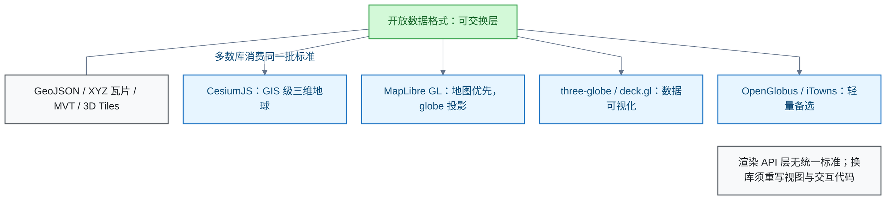

# 前端开发

<!-- domain: 前端开发 -->
**范围**：Web 前端组件与工程选型，包括可嵌入编辑器、后台设计风格与网页三维地球/地图库。

**综述**：网页编辑器先按 Markdown 往返结果、富文本交互和维护状态选型，再用实际文档验证；历史候选包括 Vditor、Milkdown Crepe，TOAST UI Editor 的归档状态见原问题。后台设计风格按信息密度与操作任务选择，合集示例仅作设计参考。三维地球按 GIS 场景、地图优先或数据展示选择 CesiumJS、MapLibre GL JS、globe.gl 等候选；开放数据格式有助于交换，渲染 API 仍各自独立，许可需按版本核对。地图服务端另行选型：空间数据发布与瓦片服务见 GIS 领域。
<!-- /domain -->

本领域记录网页前端的选型结论：可嵌入的所见即所得（What You See Is What You Get，WYSIWYG）Markdown 编辑器、后台管理界面设计风格、三维地球与地图开源库。主线是按需求场景选库；地图服务端选型属 GIS 领域，不在本文范围。

## 可嵌入的所见即所得 Markdown 编辑器选型

**结论**：要求单栏所见即所得（不要左右分栏）时，首选 Vditor，备选 Milkdown Crepe；TOAST UI Editor 仓库已归档，新项目不宜优先选用。

- **Vditor**：提供 `wysiwyg` 单栏模式、现成工具栏和 Markdown 读写 API，适合快速嵌入。
- **Milkdown Crepe**：`@milkdown/crepe` 提供开箱即用的所见即所得编辑器，适合需要进一步扩展的应用。
- **TOAST UI Editor**：支持此模式，但官方仓库已归档；维护状态是排除理由。

信源：

- [Vditor 官方 README（一手）](https://github.com/Vanessa219/vditor/blob/master/README.md)
- [Milkdown 入门文档（一手）](https://milkdown.dev/docs/guide/getting-started)
- [Milkdown Crepe API（一手）](https://milkdown.dev/docs/api/crepe)
- [TOAST UI Editor 官方仓库（一手）](https://github.com/nhn/tui.editor)

### 证据与时效 · q-20260923-010

- **信源**：[一手] [Vditor 官方 README](https://github.com/Vanessa219/vditor/blob/master/README.md)；[一手] [Milkdown 入门文档](https://milkdown.dev/docs/guide/getting-started)；[一手] [Milkdown Crepe API](https://milkdown.dev/docs/api/crepe)；[一手] [TOAST UI Editor 官方仓库](https://github.com/nhn/tui.editor)

## 后台管理项目的设计风格选型

**结论**：从 awesome-design-md 合集为后台管理项目选风格，按信息密度与操作任务分三档：通用后台用 Vercel 风格，数据密集型用 Supabase，暗色专业工具用 Linear。PostHog 与汽车、消费品品牌风格不适合。

三档适用场景与要点：

- **Vercel（通用后台首选）**：中性灰阶 + hairline 细边框 + 克制的堆叠阴影。规范自带 `ex-app-shell-row`（侧边导航行）与 `ex-data-table-cell`（数据表格）等后台壳层示例。取其 in-app 尺度：6 px 按钮、8 px 卡片；营销 pill 不进后台。
- **Supabase（数据密集型：表格、日志、SQL）**：白底近黑 + 单一祖母绿 CTA（#3ecf8e），6 px 方正圆角。本身就是数据库后台产品的语言。
- **Linear（暗色专业工具）**：近黑画布（#010102）+ 单一薰衣草紫强调（#5e6ad2），层级靠面板抬升而非阴影。

不适合的：

- **PostHog**：奶油色 + 吉祥物，规范明说产品内分析界面未采集。
- **汽车与消费品品牌风格**：大图、氛围渐变，与高密度操作界面相反。

**选型标准**：后台界面以表格、表单、侧边导航、图表为主，须中性色为主、彩色仅用于状态与主操作、小圆角、完整字阶、数据用等宽字体。

**中文化限制**：两套拉丁字体规范落在中文后台时，数字与拉丁字符按字阶走 Inter（Vercel 与 Supabase 推荐的替代），中文回退系统字体。

信源：

- [Vercel DESIGN.md（一手）](https://github.com/VoltAgent/awesome-design-md/blob/master/design-md/vercel/DESIGN.md)
- [Supabase DESIGN.md（一手）](https://github.com/VoltAgent/awesome-design-md/blob/master/design-md/supabase/DESIGN.md)
- [Linear DESIGN.md（一手）](https://github.com/VoltAgent/awesome-design-md/blob/master/design-md/linear.app/DESIGN.md)
- [PostHog DESIGN.md（一手）](https://github.com/VoltAgent/awesome-design-md/blob/master/design-md/posthog/DESIGN.md)

### 证据与时效 · q-20261022-001

- **信源**：[一手] [Vercel DESIGN.md](https://github.com/VoltAgent/awesome-design-md/blob/master/design-md/vercel/DESIGN.md)；[一手] [Supabase DESIGN.md](https://github.com/VoltAgent/awesome-design-md/blob/master/design-md/supabase/DESIGN.md)；[一手] [Linear DESIGN.md](https://github.com/VoltAgent/awesome-design-md/blob/master/design-md/linear.app/DESIGN.md)；[一手] [PostHog DESIGN.md](https://github.com/VoltAgent/awesome-design-md/blob/master/design-md/posthog/DESIGN.md)
- 原记录资料（未在迁移时复核）：[资料](https://github.com/voltagent/awesome-design-md)

## 网页端三维地球仪与地图的开源库选型

**结论**：按场景选库——GIS 级三维地球默认 CesiumJS；地图优先、球体仅作投影视图用 MapLibre GL JS；纯数据可视化用 three-globe/globe.gl 或 deck.gl。"可交换"的关键在数据层走开放格式，渲染层 API 无统一标准。

按场景的候选：

- **GIS 级三维地球（地形、倾斜摄影）**：默认 CesiumJS（Apache-2.0）；轻量备选 OpenGlobus（Apache-2.0）与 iTowns（CeCILL-B/MIT 双许可）。
- **地图优先、球体作为投影视图**：MapLibre GL JS（BSD-3-Clause）。v5.0.0 于 2025-01 起支持 globe 投影，Mercator 与球体自适应切换。
- **纯数据可视化**：three-globe / globe.gl（MIT），或 deck.gl（MIT；GlobeView 官方标注实验性）。

**"可交换"的含义**：数据层走开放格式——GeoJSON、XYZ 栅格瓦片、MVT（Mapbox Vector Tiles）、3D Tiles。多数库消费同一批标准，换库时数据层不动；交换成本集中在视图与交互代码。

**许可限制**：

- Mapbox GL JS 自 2020-12 v2 起转专有许可；MapLibre 是其 v1 开源分支。要求开源时排除 Mapbox GL JS v2+。
- Cesium ion 为商业云服务，可不用。

信源：

- [CesiumJS 仓库（一手）](https://github.com/CesiumGS/cesium)（Apache-2.0、3D Tiles/地形/glTF/CZML）
- [MapLibre GL JS 仓库（一手）](https://github.com/maplibre/maplibre-gl-js)（BSD-3、Mapbox v1 分支）
- [MapLibre Globe View 路线图（一手）](https://maplibre.org/roadmap/maplibre-gl-js/globe-view)（v5.0.0、自适应投影、未进 MapLibre Native）
- [deck.gl 仓库（一手）](https://github.com/visgl/deck.gl)（MIT、vis.gl/OpenJS）
- [deck.gl GlobeView 文档（一手）](https://deck.gl/docs/api-reference/core/globe-view)（实验性）
- [three-globe 仓库（一手）](https://github.com/vasturiano/three-globe)（MIT、图层类型）
- [OpenGlobus 仓库（一手）](https://github.com/openglobus/openglobus)（Apache-2.0）
- [iTowns 仓库（一手）](https://github.com/iTowns/itowns)（CeCILL-B/MIT、WMS/WMTS/TMS/MVT/3D Tiles/点云、IGN 维护）

### 证据与时效 · q-20261024-001

- **信源**：[一手] [CesiumJS 仓库](https://github.com/CesiumGS/cesium)（Apache-2.0、3D Tiles/地形/glTF/CZML）；[一手] [MapLibre GL JS 仓库](https://github.com/maplibre/maplibre-gl-js)（BSD-3、Mapbox v1 分支）；[一手] [MapLibre Globe View 路线图](https://maplibre.org/roadmap/maplibre-gl-js/globe-view)（v5.0.0、自适应投影、未进 MapLibre Native）；[一手] [deck.gl 仓库](https://github.com/visgl/deck.gl)（MIT、vis.gl/OpenJS）；[一手] [deck.gl GlobeView 文档](https://deck.gl/docs/api-reference/core/globe-view)（实验性）；[一手] [three-globe 仓库](https://github.com/vasturiano/three-globe)（MIT、图层类型）；[一手] [OpenGlobus 仓库](https://github.com/openglobus/openglobus)（Apache-2.0）；[一手] [iTowns 仓库](https://github.com/iTowns/itowns)（CeCILL-B/MIT、WMS/WMTS/TMS/MVT/3D Tiles/点云、IGN 维护）

## 提问记录

### q-20260923-010

- **原题**：2026-09-23 · 选用可嵌入的网页所见即所得 Markdown 编辑器
- **问**：有没有成熟、可直接嵌入网页的开源 Markdown 编辑器，要求单栏所见即所得，不要左右分栏？
- **领域**：前端开发
- **首次**：2026-09-23
- **更新**：2026-09-23
- **正文**：[可嵌入的所见即所得 Markdown 编辑器选型](#可嵌入的所见即所得-markdown-编辑器选型)

### q-20261022-001

- **原题**：2026-10-22 · 从 awesome-design-md 合集为后台管理项目选设计风格
- **问**：https://github.com/voltagent/awesome-design-md 项目中哪种风格适合后台管理项目？
- **领域**：前端开发
- **首次**：2026-10-22
- **更新**：2026-10-22
- **正文**：[后台管理项目的设计风格选型](#后台管理项目的设计风格选型)

### q-20261024-001

- **原题**：2026-10-24 · 网页端 3D 地球仪与地图的开源库选型（可交换）
- **问**：有没有网页端 3D 地球仪/地图相关的开源项目或库，需要可交换那种？
- **领域**：前端开发
- **首次**：2026-10-24
- **更新**：2026-10-26
- **正文**：[网页端三维地球仪与地图的开源库选型](#网页端三维地球仪与地图的开源库选型)
- **关联**：[2026-10-26 · 免费私有化部署的 GIS 服务选型](../系统与运维/GIS.md#q-20261026-007)
