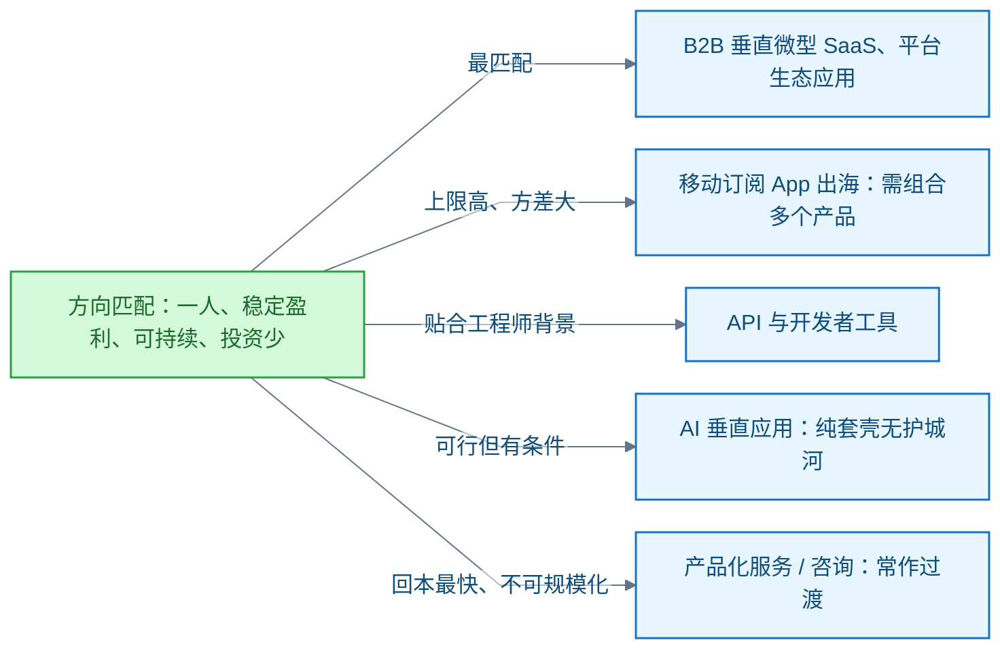
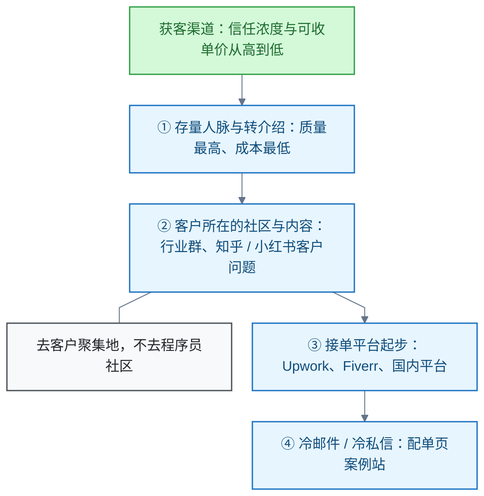

# 独立开发

<!-- domain: 独立开发 -->
**范围**：程序员一人公司创业方向、商业模式、平台分成经济、小游戏赛道与服务获客渠道。

**综述**：独立开发的方向先按获客渠道、持续付费、维护成本和个人能力匹配；垂直 SaaS、平台生态应用、工具、API 与产品化服务是不同经营方式，不保证稳定盈利。小游戏的变现、买量和收入分布有较大差异，历史统计和平台分成不能直接预测个人收益，实际决策前需重查。服务获客可从转介绍、客户社区、案例内容和接单平台逐步积累信任；平台适合作为起步渠道，长期仍需形成可重复获客。早期行业报告中的二手统计仅保留为线索。待解：细分行业选择与内容获客方法。
<!-- /domain -->

独立开发记录程序员一人公司的方向选择。主线：按获客渠道、持续付费、维护成本与个人能力匹配评估各方向。边界：各方向不保证稳定盈利，历史统计不能预测个人收益，决策前需重查。

## 一人公司创业方向的选择

一人公司创业方向按四项约束筛选：一人公司、稳定盈利、可持续、投资少。

**核心结论**：AI 时代构建不稀缺，分发与获客稀缺。据 2026 一人公司洞察报告（二手，仅作线索）：超 50% 受访者困于"如何寻找用户"，44% 选择订阅收入。因此优先选两类特征的方向：自带分发渠道（平台生态、应用商店），以及经常性收入（订阅）。

图内缩写：B2B = Business to Business（面向企业）；SaaS = Software as a Service（软件即服务）；API = Application Programming Interface（应用程序接口）。

**平台分成的条件**（各平台官方规则，金额均为美元）：

- Apple App Store 小企业计划：年收入（proceeds）不超过 100 万美元时佣金 15%。
- Google Play：每年首 100 万美元服务费 15%，超出部分 30%。
- Shopify 应用商店：应用首 100 万美元/年 0% 分成，其后 15%；另有企业规模门槛。

**信源**：

- [一手] [App Store Small Business Program（Apple 官方：年 proceeds ≤ 100 万美元佣金 15%）](https://developer.apple.com/app-store/small-business-program)
- [一手] [Google Play Service fees（官方：每年首 100 万美元 15%，超出 30%）](https://support.google.com/googleplay/android-developer/answer/112622)
- [一手] [How Partners earn on Shopify（官方：App Store 首个 100 万美元/年 0% 分成，其后 15%，另有企业规模门槛）](https://help.shopify.com/en/partners/partner-program/how-to-earn)
- [二手] [2026 一人公司洞察报告（鸿鹄汇发布，凤凰网报道）](https://finance.ifeng.com/c/8sBJGku9YcO)

### 证据与时效 · q-20261014-006

- **信源**：[一手] [App Store Small Business Program（Apple 官方：年 proceeds ≤ 100 万美元佣金 15%）](https://developer.apple.com/app-store/small-business-program)；[一手] [Google Play Service fees（官方：每年首 100 万美元 15%，超出 30%）](https://support.google.com/googleplay/android-developer/answer/112622)；[一手] [How Partners earn on Shopify（官方：App Store 首个 100 万美元/年 0% 分成，其后 15%，另有企业规模门槛）](https://help.shopify.com/en/partners/partner-program/how-to-earn)；[二手] [2026 一人公司洞察报告（鸿鹄汇发布，凤凰网报道）](https://finance.ifeng.com/c/8sBJGku9YcO)

## 小游戏赛道的上限与方差

**结论**：小游戏上限高、方差极大。它不满足"稳定、可持续"的约束，适合作为组合打法的一条线，不适合作主线。

**微信小游戏**（官方口径）：

- 赛道仍在增长：月活跃用户（Monthly Active Users，MAU）超 5 亿，2025 年商业规模增长近 20%。
- 生态由买量驱动，80% 为中小团队。
- 个人开发者的可行切口：应用内广告变现（In-App Advertising，IAA）休闲小游戏——不买量，靠平台自然流量。
- 2026 年平台让利政策：iOS MAPP 内购流水开发者得 70%，分成可转广告金。这类政策主要补贴会投流的团队，不买量的个人开发者受益有限。

**抖音小游戏**（官方结算规则）：非投广场景开发者得 60%。

**Steam 独立游戏**（二手统计）：

- 中位数生命周期流水仅约 5000 至 1.5 万美元。
- 约 10% 的开发者累计流水超 10 万美元。
- 作为"稳定盈利"路径不合格。

**限制**：历史统计和平台分成不能直接预测个人收益；实际决策前需重查。

**信源**：

- [一手] [微信小游戏虚拟支付激励政策（官方：苹果 MAPP 内购流水开发者得 70%）](https://developers.weixin.qq.com/minigame/introduction/commercialization/guide/virtual-payment.html)
- [一手] [2026 年微信小游戏广告变现激励政策（官方）](https://developers.weixin.qq.com/minigame/introduction/commercialization/guide/ad-monetization.html)
- [一手] [抖音小游戏广告收入结算规则（官方：非投广场景开发者得 60%）](https://developer.open-douyin.com/docs/resource/zh-CN/mini-game/operation1/revenue/sharingclause/mini-game)
- [二手] [2026 微信公开课 PRO 小游戏专场数据（腾讯新闻报道）](https://view.inews.qq.com/a/20260115A08GAW00)
- [二手] [Steam 独立游戏收入统计（2026，中位数 5000–1.5 万美元）](https://www.steampageanalyzer.com/blog/indie-game-revenue-data)
- [二手] [钛媒体：微信小游戏 5000 万流水让利政策解读](https://www.tmtpost.com/7942848.html)

### 证据与时效 · q-20261014-007

- **信源**：[一手] [微信小游戏虚拟支付激励政策（官方：苹果 MAPP 内购流水开发者得 70%）](https://developers.weixin.qq.com/minigame/introduction/commercialization/guide/virtual-payment.html)；[一手] [2026 年微信小游戏广告变现激励政策（官方）](https://developers.weixin.qq.com/minigame/introduction/commercialization/guide/ad-monetization.html)；[一手] [抖音小游戏广告收入结算规则（官方：非投广场景开发者得 60%）](https://developer.open-douyin.com/docs/resource/zh-CN/mini-game/operation1/revenue/sharingclause/mini-game)；[二手] [2026 微信公开课 PRO 小游戏专场数据（腾讯新闻报道）](https://view.inews.qq.com/a/20260115A08GAW00)；[二手] [Steam 独立游戏收入统计（2026，中位数 5000–1.5 万美元）](https://www.steampageanalyzer.com/blog/indie-game-revenue-data)；[二手] [钛媒体：微信小游戏 5000 万流水让利政策解读](https://www.tmtpost.com/7942848.html)

## 产品化服务的获客渠道

产品化服务（Productized Service）指把服务打包成固定产品和定价出售。四层渠道按信任浓度与可收单价排序：

**推荐顺序**：人脉冷启动 → 平台/社区攒案例与评价 → 内容长尾询盘 → 转介绍飞轮。平台是起步与攒信用的手段，不是长期主线；长期需形成可重复获客。

**平台费率与形态**：

- Upwork：自由职业者服务费 0% 至 15% 变动，自带客户 0%（官方）。
- Fiverr：抽成 20%（二手）；gig 形态即产品化服务的原生形态。
- 国内：程序员客栈、电鸭社区、码市、解放号；猪八戒比价严重（二手）。

**限制**：转介绍为第一客户来源出自自由职业调查，样本小、二手。

**信源**：

- [一手] [Upwork Pricing: Plans and Fees for Freelancers（官方：变动服务费 0–15%）](https://www.upwork.com/pricing/freelancer)
- [一手] [Upwork Freelancer Service Fee 说明（官方帮助中心）](https://support.upwork.com/hc/en-us/articles/211062538-Learn-about-the-Freelancer-Service-Fee)
- [二手] [Upwork 官方费率计算器页确认 Fiverr 抽成 20%](https://www.upwork.com/tools/fiverr-fee-calculator)
- [二手] [自由撰稿人获客调查（推荐为第一渠道，76%/89% 小样本）](https://abbeywoodcock.medium.com/where-do-creative-freelancers-actually-get-clients-d59812a1fa3a)
- [二手] [2026 年程序员接单十大平台（知乎）](https://zhuanlan.zhihu.com/p/1986855426793424215)
- [二手] [电鸭社区接单经验帖](https://eleduck.com/posts/lafgo4)

### 证据与时效 · q-20261014-008

- **信源**：[一手] [Upwork Pricing: Plans and Fees for Freelancers（官方：变动服务费 0–15%）](https://www.upwork.com/pricing/freelancer)；[一手] [Upwork Freelancer Service Fee 说明（官方帮助中心）](https://support.upwork.com/hc/en-us/articles/211062538-Learn-about-the-Freelancer-Service-Fee)；[二手] [Upwork 官方费率计算器页确认 Fiverr 抽成 20%](https://www.upwork.com/tools/fiverr-fee-calculator)；[二手] [自由撰稿人获客调查（推荐为第一渠道，76%/89% 小样本）](https://abbeywoodcock.medium.com/where-do-creative-freelancers-actually-get-clients-d59812a1fa3a)；[二手] [2026 年程序员接单十大平台（知乎）](https://zhuanlan.zhihu.com/p/1986855426793424215)；[二手] [电鸭社区接单经验帖](https://eleduck.com/posts/lafgo4)

## 提问记录

### q-20261014-006

- **原题**：2026-10-14 · 程序员一人公司的创业方向有哪些
- **问**：目前阶段程序员自主创业有哪些方向？约束：一人公司、稳定盈利、可持续、投资少。
- **领域**：独立开发
- **首次**：2026-10-14
- **更新**：2026-10-14
- **正文**：[一人公司创业方向的选择](#一人公司创业方向的选择)

### q-20261014-007

- **原题**：2026-10-14 · 做小游戏有没有前途
- **问**：程序员一人公司方向中，做小游戏有没有前途？
- **领域**：独立开发
- **首次**：2026-10-14
- **更新**：2026-10-14
- **正文**：[小游戏赛道的上限与方差](#小游戏赛道的上限与方差)

### q-20261014-008

- **原题**：2026-10-14 · 产品化服务/咨询去哪里找客户
- **问**：以产品化服务（Productized Service）/咨询为例，客户从哪里来？
- **领域**：独立开发
- **首次**：2026-10-14
- **更新**：2026-10-14
- **正文**：[产品化服务的获客渠道](#产品化服务的获客渠道)
